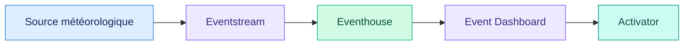
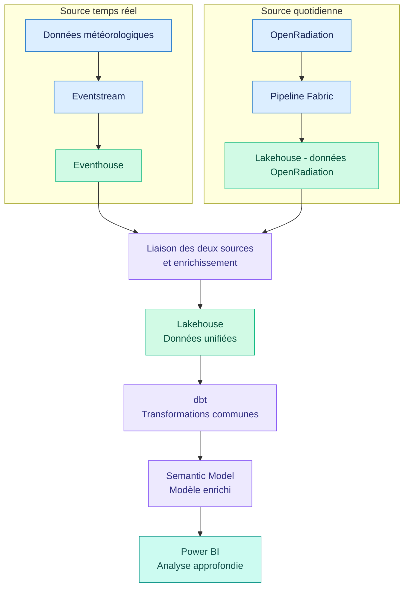
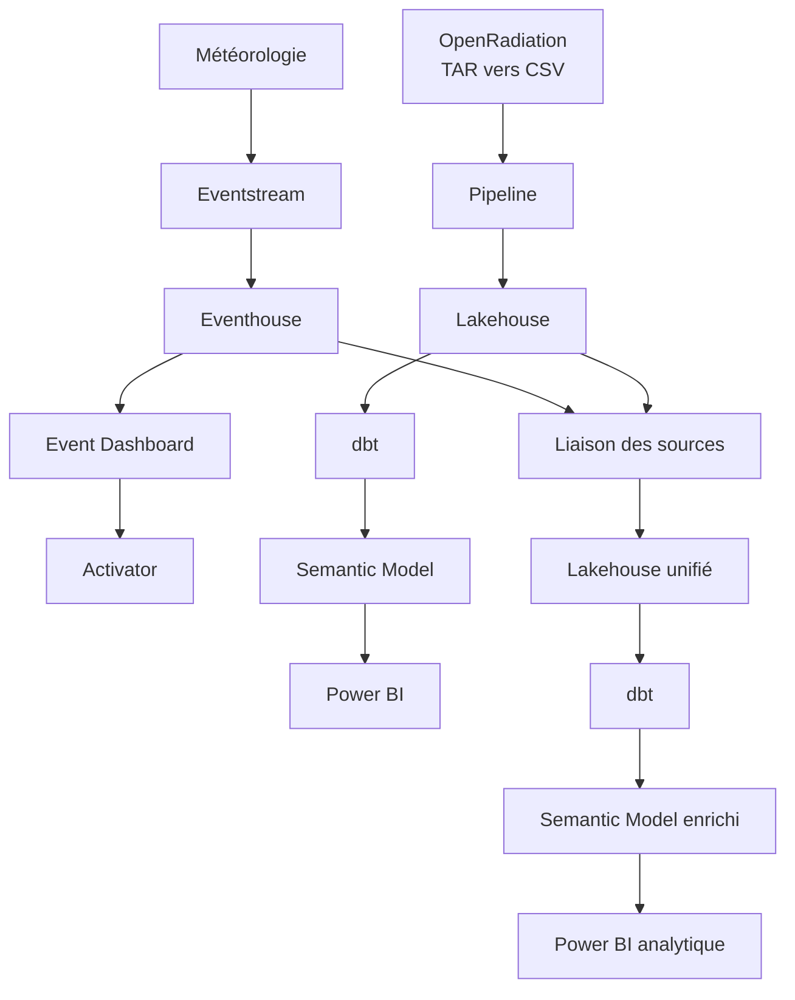
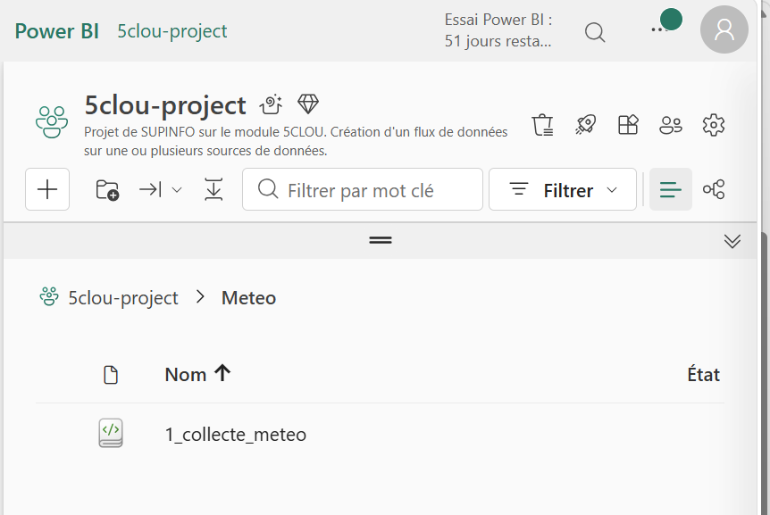

# 5CLOU - Projet de construction d'un flux de données en temps réels via Microsoft Fabric
## Auteur : Julien RENOULT - Béatrice BEAVOGUI
## Promo : SUPINFO Programme Grande École 5ème année
### *Spécialité : Ingénierie Data*
### *Date : 21/10/2026*
### Lien Projet : ...

# Introduction

Dans le cadre de ce projet, nous devions construire une architecture Fabric permettant de collecter les données en temps réels pour la météorologie
 et les mesures de radiations dans notr projet.

Pour réaliser ce projet, plusieurs technologies devront être utilisées :
- **Fabric** : outil cloud central pour la création de la pipeline de bout en bout
- **dbt** : pour le traitement analytique et nettoyage de nos données avec des processus ELT
- **Python/Jupyter/Spark** : pour l'exploration, le traitement et la visualisation de nos données
- **Power BI** : pour les rapports et tableaux de bords visuels et interactifs

La problématique de notre projet est de voir les conditions météorologiques en temps réels de ce qui se passe et la liaison avec les mesures radiologiques.


# Collecte des données en temps réels des stations

Pour pouvoir collecter les données météorologiques en temps réels, nous allons utiliser cette route d'API toutes les 6 minutes afin de capturer les dernières mesures météorologiques :

https://public-api.meteofrance.fr/public/DPPaquetObs/v2/paquet/stations/infrahoraire-6m

Header : apikey: ...

format : json

date : YYYY-mm-DDTHH:MM:00Z (attention multiple de 6 pour les minutes et décalage de deux heures par rapport à l'heure française, UTC format !)


Pour tester avec curl, définissez la variable de votre TOKEN avec la valeu du token concernée :

```bash

TOKEN = valeur-token

```

pour capturer la liste des stations disponibles :

```bash
curl -X 'GET' \
  'https://public-api.meteofrance.fr/public/DPPaquetObs/v2/liste-stations' \
  -H 'accept: */*' \
  -H "apikey: Bearer "
```

pour capturer les observations météorologiques :

```bash
curl -X 'GET' 'https://public-api.meteofrance.fr/public/DPPaquetObs/v2/paquet/stations/infrahoraire-6m? date=2026-10-23T20%3A00%3A00Z&format=json' \   
    -H 'accept: */*'   -H "apikey: $TOKEN"
```

Si on ne veut pas capturer toutes les six minutes :

```bash

curl -X 'GET' \
  'https://public-api.meteofrance.fr/public/DPPaquetObs/v2/paquet/stations/horaire?date=2026-10-23T20%3A00%3A00Z&format=json' \
  -H 'accept: */*' -H "apikey: $TOKEN"

```

Si je veux me concentrer sur une station :

```bash 
curl -X 'GET' \
  'https://public-api.meteofrance.fr/public/DPPaquetObs/v2/paquet/infrahoraire-6m?id_station=01014002&format=json' \
  -H 'accept: */*' \
  -H "apikey: $TOKEN"
```

Si je veux me concentrer sur un département précis :

```bash 

curl -X 'GET' \
  'https://public-api.meteofrance.fr/public/DPPaquetObs/v2/paquet/horaire?id-departement=76&format=json' \
  -H 'accept: */*' \
  -H "apikey: $TOKEN"
```

Cette route sera appelée à travers soit d'un event ou d'un notebook python.

C'est une authentification par clé qui sera effectuée et renouvelé toutes les deux semaines (à automatiser !).

# Collecte des données de mesures de radiations 

Pour pouvoir observer les mesures de radiations relevés par les citoyens à travers tous le territoires français, nous pourrons nous baser sur deux types de sources de données :

- fichier CSV mise à jour quotidiennement : https://request.openradiation.net/download.html

- API OpenRadiation pour faire de la collecte des mesures de radiations collectives avec cette route : https://request.openradiation.net/measurements?apiKey=...&minStartTime=2026-10-21T15:00:00.0000&&maxStartTime=2026-10-21T19:05:59.000


Réflexion sur le streaming ou mise à jour quotidienne.

Choix : prendre la mise à jour quotidienne pour le moment avec openradiation en utilisant un autre processus. L'objectif est d'abord d'étudier le lien entre l'openradiation de ses mesures et l'historique des données météorologiques rencontrées pour ces stations.

# Pipeline Fabric à construire 

## 1. Flux RIT — Temps réel



**Objectif :** ingérer et visualiser les données météorologiques en temps réel, puis déclencher des actions à l'aide d'Activator.

## 2. Flux quotidien — OpenRadiation

```mermaid
flowchart LR
    A["OpenRadiation<br/>Archive TAR"] --> B["Décompression<br/>Extraction du CSV"]
    B --> C["Pipeline Fabric"]
    C --> D["Lakehouse"]
    D --> E["dbt"]
    E --> F["Semantic Model"]
    F --> G["Power BI"]
    G -. "Déclenchement d'actions" .-> H["Activator"]

    classDef source fill:#FEF3C7,stroke:#D97706,color:#78350F
    classDef ingestion fill:#DCEEFF,stroke:#3182CE,color:#172554
    classDef storage fill:#D1FAE5,stroke:#10B981,color:#064E3B
    classDef transform fill:#EDE9FE,stroke:#8B5CF6,color:#312E81
    classDef visual fill:#CCFBF1,stroke:#0D9488,color:#134E4A

    class A,B source
    class C ingestion
    class D storage
    class E,F transform
    class G,H visual
```



**Objectif :** récupérer quotidiennement les données OpenRadiation, extraire le fichier CSV, charger les données dans le Lakehouse, les transformer avec dbt et les exposer dans Power BI.

*Remarque :* le lien entre Power BI et Activator est représenté comme un déclenchement d'actions à configurer selon le mécanisme retenu. Activator peut notamment réagir à des conditions détectées sur des données Power BI.

## 3. Flux combiné — Liaison des deux sources et analyse approfondie



**Objectif :** rapprocher les données météorologiques et les mesures OpenRadiation pour construire une vision consolidée, faciliter les analyses croisées et alimenter des rapports Power BI enrichis.

La liaison doit s'appuyer sur des clés communes pertinentes, par exemple la date, l'heure ou la localisation, selon la granularité et la disponibilité des données.

## 4. Vue d'ensemble des flux



## 5. Légende des éléments

| Élément | Rôle |
|---|---|
| Eventstream | Ingestion et traitement des événements en temps réel |
| Eventhouse | Stockage et interrogation des données événementielles |
| Event Dashboard | Visualisation des événements et indicateurs en temps réel |
| Activator | Détection de conditions et déclenchement d'actions |
| Pipeline Fabric | Orchestration des étapes d'ingestion |
| Lakehouse | Stockage des données et préparation des traitements analytiques |
| dbt | Transformation, modélisation et tests des données |
| Semantic Model | Exposition des données selon un modèle métier |
| Power BI | Visualisation et analyse des données |


Pour la construction de ces différentes parties de clux, ne pas oublier :
- de documenter les manipulations effectuées pour créer ces différentes parties de flux (faire des captures d'écran)
- les raisons du pourquoi, du comment et à quoi ça sert
- ce que ça permis d'apporter et réponds à quels contraintes d'existence

 # Mise en oeuvre du flux météorologique avec Mirosoft Fabric
 ## 1. Préparation de l'environnement
  Pour développer la partie météorologique du projet 5CLOU, nous avons commencé par préparer notre environnement de travail dans Microsoft Fabric.
 Dans le workspace partagé **5CLOU-project**, nous avons créé un dossier **météo** afin d'organiser les ressources dédiées aux données météorologiques.
 Nous avons ensuite créé un notebook nommé **1_collecte_meteo**.
 ### Pourquoi cette organisation?
 Elle permet de développer séparément les flux météorologiques et radiologiques  avant de les réunir pour effectuer des analyses communes.
 ### Résultat:
 Notre environnement est prêt pour commencer la collecte des observations métérologiques à partir de l'API Méteo-France.
 Les étapes suivantes seront documentées progressivement, avec les résultats obtenus et captures d'écrans correspondantes.
 ### Capture d'écran de l'environnement


