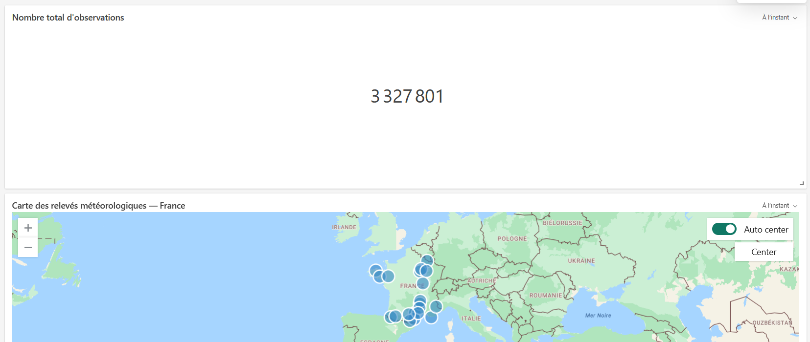
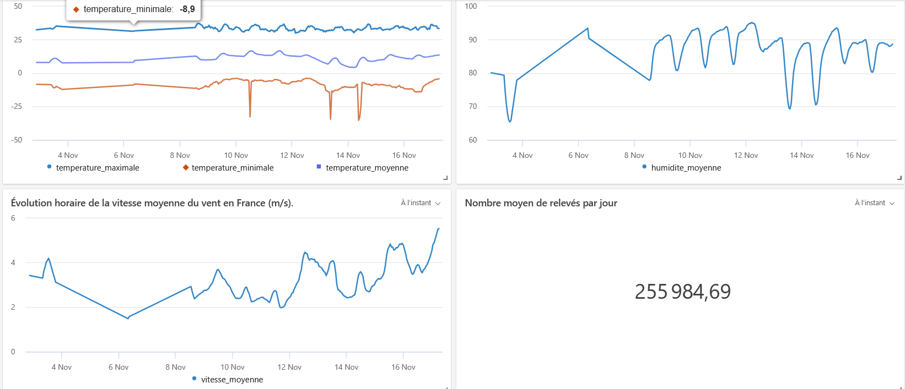
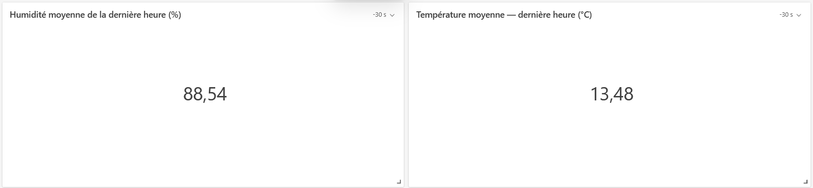

# Dashboard météorologique — Meteo_RIT

## 1. Descriptif rapide

- **Nom :** Meteo_RIT
- **Type :** Dashboard temps réel (Real-Time Dashboard) Microsoft Fabric
- **Espace de travail :** 5clou-project
- **Source de données :** Eventhouse_meteo_France
- **Table source :** stream_meteo_france

Le dashboard Meteo_RIT permet de visualiser et d'analyser **les observations météorologiques collectées à partir de Météo-France**.

Il présente plusieurs indicateurs et visualisations, notamment le nombre d'observations, la répartition géographique des relevés météorologiques et l'évolution horaire des températures en France.

Les données sont consultables selon un intervalle temporel sélectionné par l'utilisateur.

Sommaire pour explorer d'autres types, ressources :

- [Accueil](../../../../README.md)
- [Dashboard RIT](../README.md)

## 2. Quoi ?

Le dashboard **Meteo_RIT** est un tableau de bord interactif développé dans Microsoft Fabric pour suivre et analyser les observations météorologiques en France.

Il comprend notamment :

- **Nombre total d'observations :** indicateur permettant de suivre le volume de relevés météorologiques.
- **Carte des relevés météorologiques :** visualisation géographique des stations et des observations disponibles.
- **Évolution horaire des températures :** graphique permettant d'observer les variations des températures au fil du temps.
- **Filtre temporel :** fonctionnalité permettant de sélectionner une période d'analyse, par exemple les sept derniers jours.

Les visualisations exploitent les données stockées dans la table `stream_meteo_france` de l'Eventhouse et permettent une consultation interactive des informations météorologiques.

## 3. Pourquoi ?

Dans notre projet 5CLOU, nous collectons des observations météorologiques provenant de Météo-France. Ces données sont stockées dans Microsoft Fabric, mais leur consultation sous forme de tables ne permet pas d'identifier facilement les tendances et les variations météorologiques.

Nous avons donc créé le dashboard **Meteo_RIT** pour transformer ces données en informations visuelles directement exploitables.

Ce dashboard répond à plusieurs besoins :

- **Suivre les données collectées :** visualiser le volume d'observations disponibles.
- **Analyser les températures :** observer leur évolution au fil des heures.
- **Visualiser la répartition géographique :** localiser les relevés météorologiques sur une carte.
- **Faciliter l'analyse :** consulter les informations sur différentes périodes grâce au filtre temporel.
- **Valoriser les données du projet :** rendre les résultats de notre pipeline de collecte accessibles et compréhensibles.

Le dashboard constitue ainsi la couche de visualisation de notre flux météorologique et complète les traitements de données réalisés dans Microsoft Fabric.

## 4. Sources et destinations

### Source des données

Les observations météorologiques proviennent de **Météo-France** et sont collectées dans notre environnement Microsoft Fabric.

Pour alimenter le dashboard, nous utilisons les éléments suivants :

- **Espace de travail :** `5clou-project`
- **Eventhouse :** `Eventhouse_meteo_France`
- **Table source :** `stream_meteo_france`
- **Outil de visualisation :** Real-Time Dashboard de Microsoft Fabric

### Destination des données

Les données sont exploitées directement par le dashboard **`Meteo_RIT`**, qui permet de les présenter sous forme d'indicateurs, de graphiques et de carte géographique.

### Fonctionnement du flux

`Météo-France → Collecte des observations → Eventhouse → Table stream_meteo_france → Dashboard Meteo_RIT`

Le dashboard interroge les données disponibles dans l'Eventhouse. Il est indépendant du pipeline quotidien de transformation Bronze/Silver, qui prépare les données pour d'autres usages analytiques.

## 5. Comment ?

### 5.1. Création et connexion du dashboard

Nous avons créé un dashboard temps réel nommé **Meteo_RIT** dans notre espace de travail Microsoft Fabric `5clou-project`.

Pour afficher les observations météorologiques, nous avons utilisé les données stockées dans l'Eventhouse `Eventhouse_meteo_France`, et plus précisément dans la table `stream_meteo_france`.

Cette connexion permet au dashboard d'interroger les données météorologiques disponibles dans l'Eventhouse et de les restituer sous forme de visualisations interactives.

Les différentes visualisations ont ensuite été organisées dans le dashboard afin de faciliter la lecture et l'analyse des observations.
