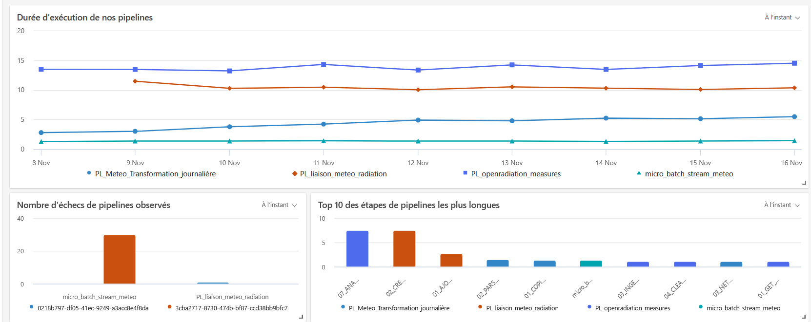
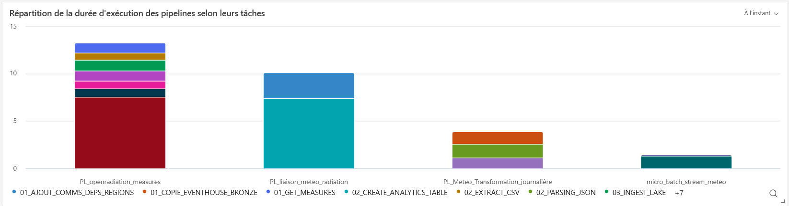

# Descriptif rapide 
- Nom : RIT_monitoring_pipelines
- Type : Dashboard RIT
- Date de modification : 16/11/2026
- Description : un dashboard en temps réel observant précisément les activités de type pipeline

## Quoi ?

C'est un élément permettant de créer un dashboard en temps réel à partir d'un eventhouse.

L'eventhouse utilisé en question est appelé **monitorin_eventhouse** qui contient les informations nécessaires des pipelines.

Nous y observons principalement les activités de type Pipeline.

## Pourquoi ?

Ce dashboard RIT à pour but de surveiller l'exécution des pipelines à travers deux grands axes :
- les durées d'exécution de nos pipelines et de leurs activités
- le nombre d'erreur produits sur l'exécution de ces pipelines planifiées

Elles permettront d'agir dans l'optimisation de nos pipelines en identifiant les étapes qui ralentissent le plus les performances de nos pipelines et les pipelines qui produisent le plus d'erreur dans leurs actualisation.

## Sources et destinations — Flux de données et dépendances

### Source 

Récupération à partir de requêtes KQL calculant le temps d'exécution et d'autres indicateurs statistiques sur les pipelines dans l'eventhouse **monitoring_eventhouse**.
