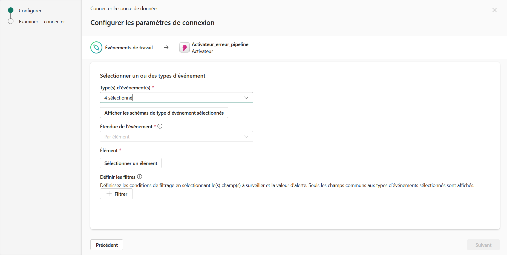
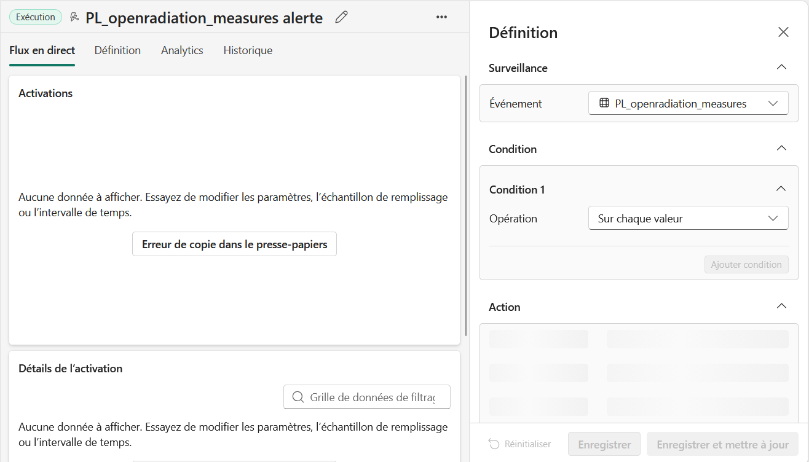
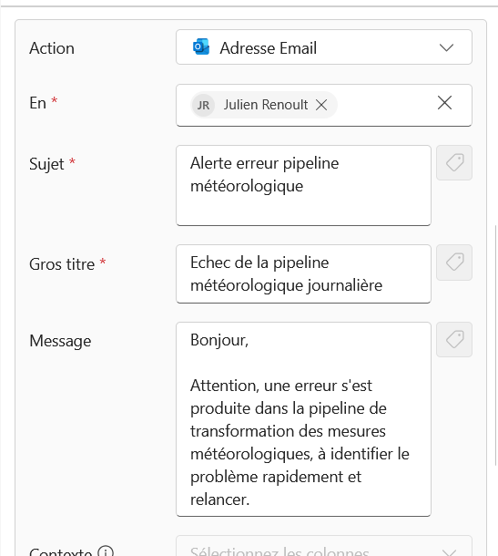

# Descriptif rapide 
- Nom : Activateur_erreur_pipeline
- Type : Activator
- Dossier : Monitoring
- Date de modification : 17/11/2026
- Description : un activateur qui alerte sur les erreurs de monitoring observées.

Sommaire pour explorer d'autres types, ressources :

- [Accueil](../../../../README.md)
- [Activateurs](../README.md)

## Quoi ?

C'est un élément d'activateur qui permets d'envoyer un mail en cas d'erreurs observées sur les pipelines suivantes :
- PL_liaison_meteo_radiation
- PL_Meteo_Transformation_journaliere
- PL_openradiation

Elle se base sur une source à part des événements de travail.

## Pourquoi ?

Dans nos pipelines que nous avons créé, nous avons mis en place des emails envoyant un mail d'erreur pour certaines étapes précises.

Cependant si l'étape concernée est un succès et que les prochaines étapes sont en échecs, nous les détecterons pas.

C'est pour cela qui faut pouvoir identifier l'erreur d'échec de pipeline quelque soit l'étape et c'est grâce à cette activator.

## Comment ?

Pour pouvoir les observer, il faut créer un événement qui surveille les activités d'une pipeline en choissisant l'onglet "Événements de travail" et ensuite choisir l'élément de pipeline en question.

Pour chaque pipeline, il sera surveillé quotidiennement et enverra un email en cas d'erreurs observées.

Pour la pipeline des mesures de radiations :

Pour la pipeline des mesures météorologiques (transformation journalière) :

Pour la pipeline de la liaison des deux types de mesures :

