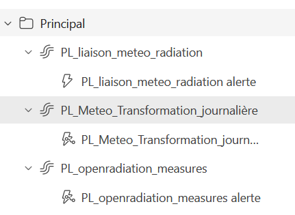
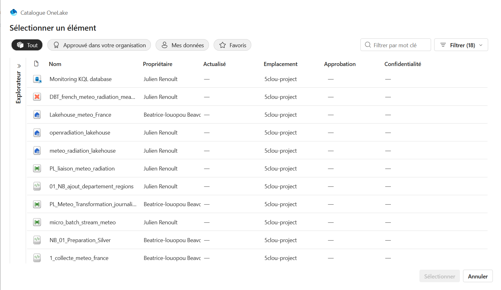
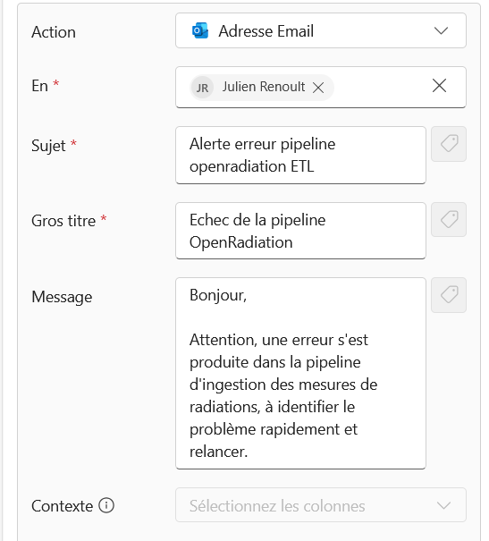
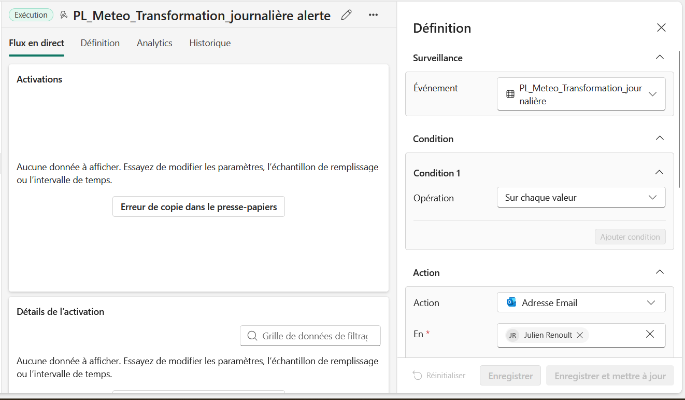
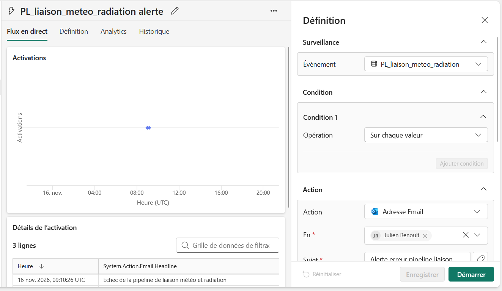
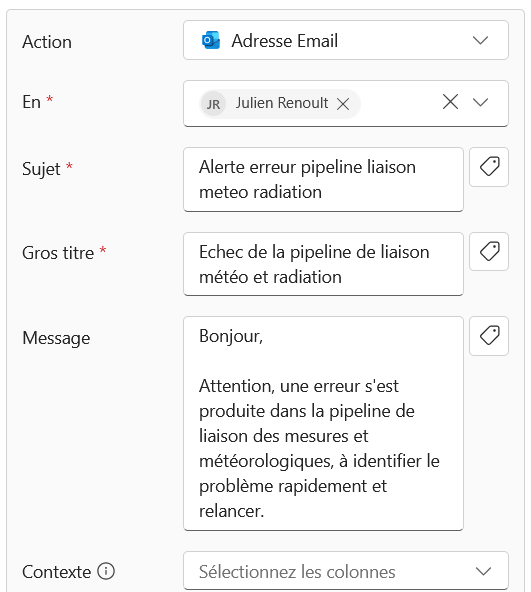

# Descriptif rapide 
- Nom : Activateur_erreur_pipeline
- Type : Activator
- Dossier : Monitoring
- Date de modification : 17/11/2026
- Description : un activateur qui alerte sur les erreurs de monitoring observées.

Sommaire pour explorer d'autres types, ressources :

- [Accueil](../../../../README.md)
- [Activateurs](../README.md)

## Quoi ?

Il s’agit d’un élément d’activateur permettant d’envoyer un e-mail en cas d’erreur détectée lors de l’exécution de l’un des pipelines suivants :

- PL_liaison_meteo_radiation
- PL_Meteo_Transformation_journaliere
- PL_openradiation

Elle se base sur une source à part des événements de travail.

## Pourquoi ?

Dans nos pipelines, nous avons mis en place des envois d'e-mails d'erreur pour certaines étapes précises.

Cependant, si une étape se termine avec succès, mais que les étapes suivantes échouent, nous ne serons pas en mesure de détecter ces erreurs avec ce système.

C'est pourquoi il est nécessaire de pouvoir identifier les erreurs d'exécution d'un pipeline, quelle que soit l'étape concernée. C'est précisément le rôle de cet activateur, qui permet de détecter les échecs au niveau du pipeline et d'envoyer une notification par e-mail.

## Comment ?

Pour pouvoir les observer, il faut créer un événement qui surveille les activités d'une pipeline en choissisant l'onglet "Événements de travail" et ensuite choisir l'élément de pipeline en question.

Chaque pipeline sera surveillée quotidiennement et enverra un email en cas d'erreurs observées.

Pour le pipeline des mesures de radiations :

Pour le pipeline des mesures météorologiques (transformation journalière) :

Pour le pipeline de la liaison des deux types de mesures :

