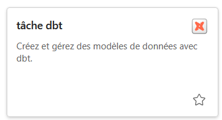
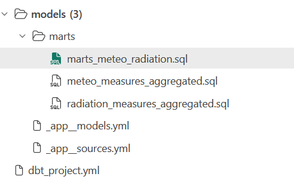
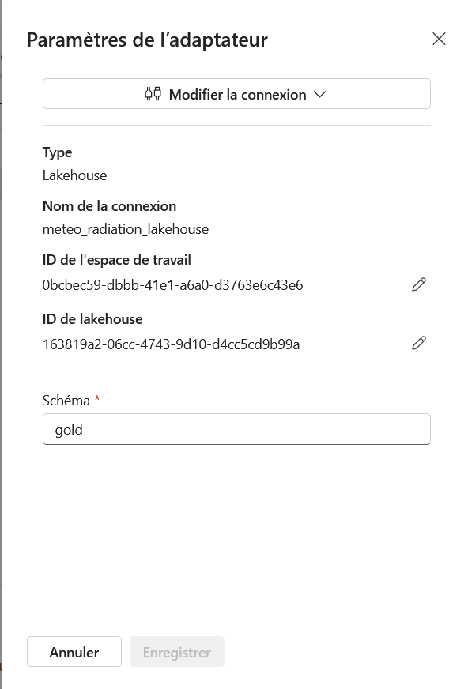

# Descriptif rapide 
- Nom : DBT_french_meteo_radiation_measures
- Type : DBT jobs
- Date de modification : 14/11/2026
- Description : un environnement dbt pour analyser les liaisons météorologiques et de radiations

## Quoi ?

C'est un élément de dbt jobs qui permets de créer les tables analytiques dans la version gold du lakehouse nommé **meteo_radiation_lakehouse**.

## Pourquoi ?

DBT est un outil très populaire permettant de centralisé nos requêtes analytiques en créant des modèles et

les tester pour vérifier la qualité des données.

Cela facilitera donc la gestion des tables analytiques avec les tests, le versioning et la centralisation de toutes ces requêtes dans un environnement commun.

De plus, dans le cadre de cette analyse de liaison, cela nous permettra de l'analyser plus facilement en voyant l'impact ou non de la météo sur les mesures de radiations relevées.

## Sources et destinations — Flux de données et dépendances

### Source 

La source de données utilisée pour créer les tables analytiques est le lakehouse **meteo_radiation_lakehouse** sur les tables *silver*.

### Destination

Enregistrée dans le même lakehouse dans le schéma *gold* utilisé après par le modèle sémantique et le Power BI.

## Comment ?

On a créé d'abord l'élément dbt jobs. 

Ensuite nous
avons créé **nos différentes tables analytiques** en créant un fichier pour chacune de ces tables.

Ces tables en questions représentent :

| nom | description | colonnes | sources | destination |
|---|---|---|---|---|
| `radiation_measures_aggregated` | Table agrégeant les mesures de radiation au niveau régional et journalier, avec calcul du nombre de relevés distincts, de la moyenne, de la médiane et des quartiles. | `date`, `region`, `nb_lignes`, `moyenne`, `mediane`, `q1`, `q3` | `silver.french_ground_measures` | `gold.radiation_measures_aggregated` |
| `meteo_measures_aggregated` | Table agrégeant les observations météorologiques au niveau régional et journalier, avec calcul du nombre d'observations et des moyennes des différents indicateurs météorologiques. | `date`, `region`, `nb_lignes`, `moyenne_temp_k`, `moyenne_humidite_pct`, `moyenne_vitesse_vent`, `moyenne_direction_vent`, `moyenne_precipitations`, `moyenne_temp_c` | `silver.silver_french_meteo_measure` | `gold.meteo_measures_aggregated` |
| `marts_meteo_radiation` | Table analytique croisant les indicateurs météorologiques et les statistiques de radiation par région et par jour afin d'étudier leurs éventuelles relations. | `date`, `region`, `nb_observations_meteo`, `moyenne_temp_k`, `moyenne_temp_c`, `moyenne_humidite_pct`, `moyenne_vitesse_vent`, `moyenne_direction_vent`, `moyenne_precipitations`, `nb_observations_radiation`, `moyenne_radiation`, `mediane_radiation`, `q1_radiation`, `q3_radiation` | `gold.meteo_measures_aggregated`, `gold.radiation_measures_aggregated` | `gold.marts_meteo_radiation` |

Pour pouvoir les envoyer dans le schéma *gold* concernée, une petite configuration à dû être faite sur l'élément en question pour pouvoir le définir.

## Fichiers associés à cette ressource

| Fichier | Rôle |
|---|---|
| `dbts/DBT_french_meteo_radiation_measures` | Export du job dbt concerné avec ses modèles |

## Exploration du projet DBT

Si vous voulez explorer plus précisément le projet DBT concerné, vous pourrez explorer le code à travers ce 
[lien](../../../../dbts/DBT_french_meteo_radiation_measures/).
