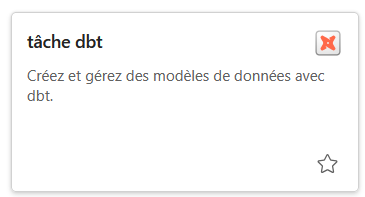
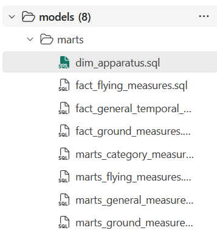
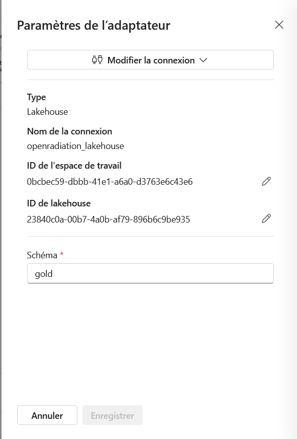

# Descriptif rapide 
- Nom : DBT_openradiation
- Type : dbt jobs
- Date de modification : 16/11/2026
- Description : un environnement dbt pour analyser les données de radiations

## Quoi ?

C'est un élément de dbt jobs qui permets de créer les tables analytiques dans la version gold du lakehouse nommé **openradiation_lakehouse**.

## Pourquoi ?

DBT est un outil très populaire permettant de centralisé nos requêtes analytiques en créant des modèles et

les tester pour vérifier la qualité des données.

Cela facilitera donc la gestion des tables analytiques avec les tests, le versioning et la centralisation de toutes ces requêtes dans un environnement commun.

## Sources et destinations — Flux de données et dépendances

### Source 

La source de données utilisée pour créer les tables analytiques est le lakehouse **openradiation_lakehouse** sur les tables *silver*.

### Destination

Enregistrée dans le même lakehouse dans le schéma *gold* utilisé après par le modèle sémantique et le Power BI.

## Comment ?

On a créé d'abord l'élément dbt jobs. 

Ensuite nous
avons créé **nos différentes tables analytiques** en créant un fichier pour chacune de ces tables.

Ces tables en questions représentent :

| nom | description | colonnes | sources | destination |
|---|---|---|---|---|
| `dim_apparatus` | Référence des appareils distincts utilisés. | `apparatusId`, `apparatusSensorType`, `apparatusTubeType` | `silver.clean_measures` | `gold.dim_apparatus` |
| `fact_flying_measures` | Table de faits regroupant les mesures effectuées en vol, avec une distinction entre les trois positions de relevé : FIRST, MID et LAST. | `endTime`, `airportOrigin`, `airportDestination`, `measurementPosition`, `value`, `latitude`, `longitude`, `apparatusId`, `userId`, `reliability`, `dury`, `reportUuid` | `silver.flying_measures` | `gold.fact_flying_measures` |
| `fact_general_temporal_values` | Table de faits centralisant les mesures générales avec leurs caractéristiques temporelles. | `endDate`, `apparatusId`, `dury`, `userId`, `measurementEnvironment`, `value`, `atypical`, `qualification`, `reportUuid` | `silver.clean_measures` | `gold.fact_general_temporal_values` |
| `fact_ground_measures` | Table de faits regroupant exclusivement les mesures réalisées au niveau du sol, identifiées par leur qualification `groundlevel`. | `endTime`, `endLatitude`, `endLongitude`, `apparatusId`, `value`, `userId`, `reportUuid`, `measurementEnvironment`, `dury`, `qualification`, `reliability` | `silver.ground_measures` | `gold.fact_ground_measures` |
| `marts_category_measures` | Table statistique présentant le nombre de mesures recensées pour chaque catégorie de qualification. | `qualification`, `effectif` | `silver.clean_measures` | `gold.marts_category_measures` |
| `marts_flying_measures` | Table statistique présentant le nombre de vols par couple d'aéroports d'origine et de destination ainsi que leur proportion dans l'ensemble des vols. | `airportOrigin`, `airportDestination`, `number_of_flights`, `route_proportion` | `gold.fact_flying_measures` | `gold.marts_flying_measures` |
| `marts_general_measures` | Table statistique regroupant les indicateurs 
descriptifs des mesures selon trois axes d'analyse : qualification, période temporelle et appareil utilisé. | `analysis_type`, `qualification`, `apparatusId`, `measurementYear`, `measurementMonth`, `number_of_measures`, `radiation_effective`, `radiation_mean`, `radiation_median`, `radiation_q1`, `radiation_q3`, `atypical_proportion` | `gold.fact_general_temporal_values` | `gold.marts_general_measures` |
| `marts_ground_measures` | Table statistique présentant 
la répartition des mesures au sol selon leur environnement de mesure, en effectif et en proportion. | `measurementEnvironment`, `number_of_measures`, `environment_proportion` | `gold.fact_ground_measures` | `gold.marts_ground_measures` |

Pour pouvoir les envoyer dans le schéma *gold* concernée, une petite configuration à dû être faite sur l'élément en question pour pouvoir le définir.

