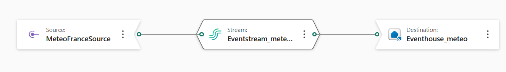
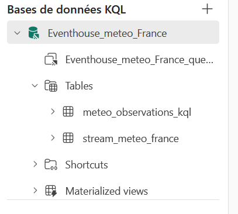
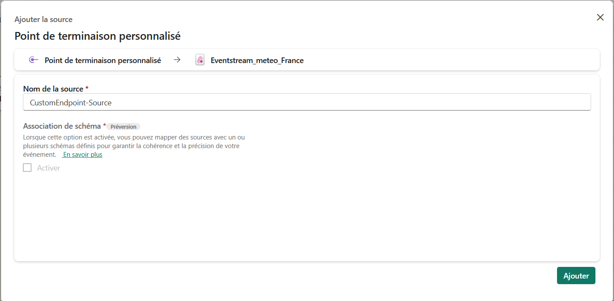
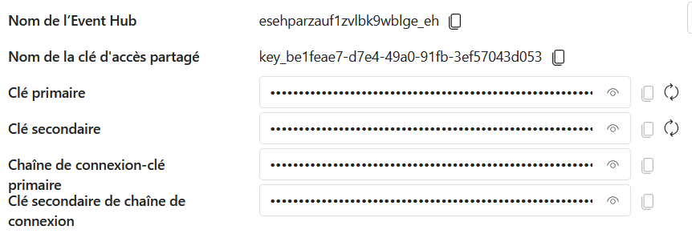
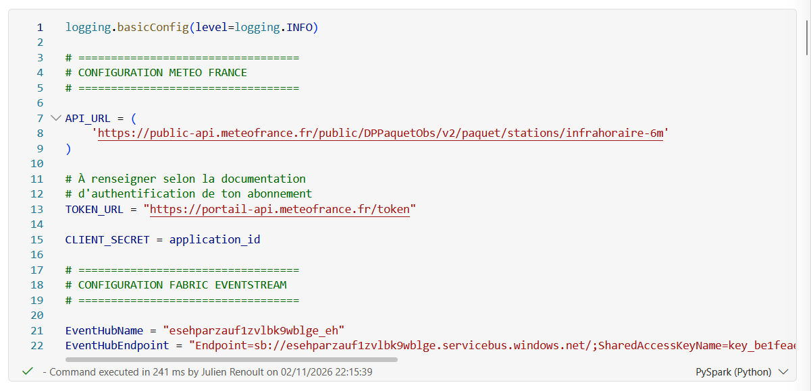

# Descriptif rapide 
- Nom : evenstream_meteo_france
- Type : EventStream
- Date de modification : 03/11/2026
- Description : un flux d'événement de données en direct pour les observations météorologiques des stations

## Quoi ?

C'est un élément de stream permettant de connecter entre le notebook **NB_Event_Meteo_France** envoyant les données de météorologie
et l'eventhouse **Event_meteo** pour stocker les données capturés par le stream connector.

Elle permets donc de lier ces deux éléments pour la collecte et le stockage de ces données.

## Pourquoi ?

Il permets de gérer la connectivité entre nos deux éléments pour la gestion du flux en quasi temps réels.

Pour ce faire, un custom stream connector nommé **MeteoFranceSource** a dû être créé pour pouvoir être utilisé avec le notebook. 

Enfin, quand l'eventStream a capturé ces données, il les envoie à l'eventhouse de destination sous le nom de table **stream_meteo_france** dans la base de données KQL **Eventhouse_meteo_france**.

## Sources et destinations — Flux de données et dépendances

### Source 

Notebook exécuté toutes les six minutes dans la source pour collecter les données météorologiques.

### Destination

Qui va ensuite être enregistré dans l'eventhouse en question sous le nom de table **stream_meteo_france** dans la base de données KQL **Eventhouse_meteo_france**.

## Comment ?

On a créé d'abord l'élément eventstream, ensuite nous
avons créé un **point de terminaison personnalisé** permettant de créer un Azure Eventhub qui peut-être utilisé dans notre notebook en question.

Pour pouvoir l'utiliser avec le notebook, il faut récupérer les éléments en question pour l'eventhub name et la chaîne de connexion-clé primaire.

Quand on a récupéré ces éléments, il ne reste plus qu'à l'appliquer dans notre notebook.

