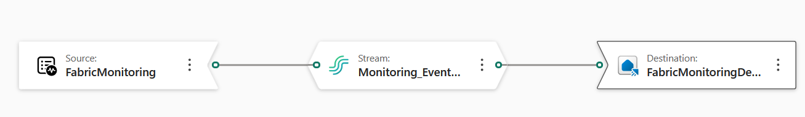
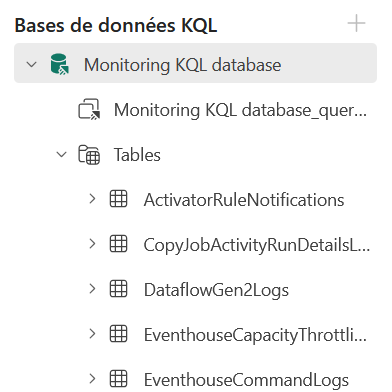

# Descriptif rapide 
- Nom : Monitoring_eventstream
- Type : EventStream
- Date de modification : 16/11/2026
- Description : un flux d'événement de données en direct pour capturer les activités réalisées dans cet espace de travail

## Quoi ?

C'est un élément de stream permettant de connecter entre la source **FabricMonitoring** et l'eventhouse **Monitoring Eventhouse**.

Ces données proviennent des activités réalisées à succès, en attente et en échec dans l'espace de travail.

Elle permets donc de collecter et de surveiller les jobs et pipelines exécutées dans cet espace.

## Pourquoi ?

Il permets de savoir le temps et les succès et échec de nos exécutions planifiés facilement grâce à ce système de flux. 

Enfin, quand l'eventStream a capturé ces données, il les envoie à l'eventhouse de destination sur plusieurs tables dans la base de données KQL **Monitoring KQL Database**.

## Sources et destinations — Flux de données et dépendances

### Source 

Les logs d'activités à succès, en attente ou en échec dans cet espace de travail.

### Destination

Qui va ensuite être enregistré dans l'eventhouse en question dans la base de données KQL **Monitoring KQL Database**.

## Comment ?

Comment créer cet eventStream avec l'eventhouse est hyper simple, il suffit juste d'aller les paramètres de l'espace de travail et ensuite aller sur l'onglet **Supervision** et cliquer sur la case à cocher *Journaliser l'activité de l'espace de travail*.

Cela permettra de créer automatiquement l'eventstream et l'eventhouse pour collecter les données des activités exécutées dans cet espace et donc procéder à une supervision dans nos traitements planifiés.

