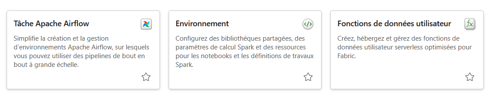
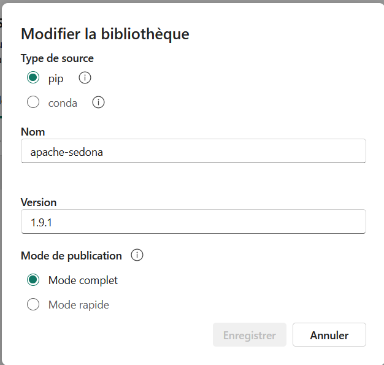
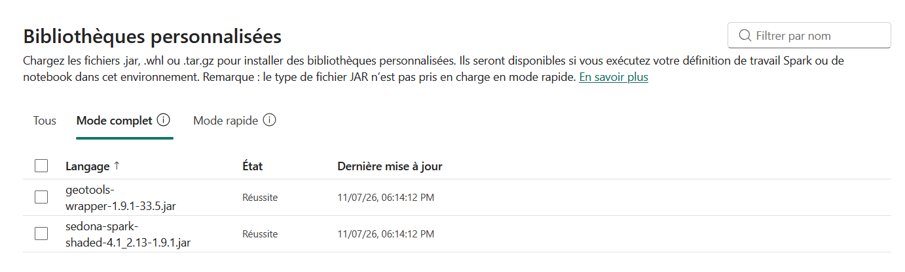
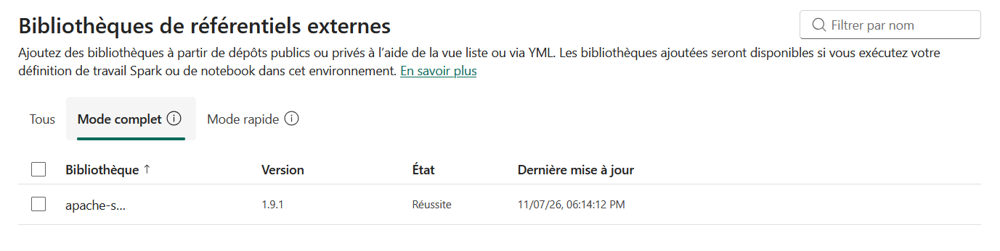

# Descriptif rapide 
- Nom : environnement_spatial
- Type : Environment
- Date de modification : 16/11/2026
- Description : un environnement Spark/Python créé spécifiquement pour ajouter la dépendance spatio-temporelle Sedona

## Quoi ?

C'est un élément d'environnement de spark/python permettant d'installer en plus des dépendances de base l'extension Sedona. 

Cet environnement est donc utilisé par le notebook **01_NB_ajout_departement_regions** pour la liaison spatiale entre les coordonnées de nos mesures (latitude, longitude) et les contours administratifs des régions, départements et communes Française.

## Pourquoi ?

Pour éviter de répéter l'installation de cette dépendance et de pouvoir gérer plus facilement les librairies de spatio-temporelle.

## Sources et destinations — Flux de données et dépendances

### Source 

Pas de source 

### Destination

Utilisé par le notebook pour pouvoir lier les contours administratifs avec les mesures.

## Comment ?

On a créé d'abord l'élément Environnement avec le nom donné. 

Ensuite, nous avons ajouté la librairie python en plus qui est *apache-sedona* avec PyPI. 

De plus, nous devions ajouter ces dépendances JAR en les uploadant dans cet environnement.

Enfin, après installation au bout de 10 minutes, nous avons la librairie d'installée qui peut être utilisé par tout notebook utilisant cet environnement.

