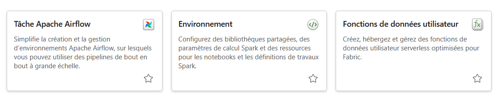
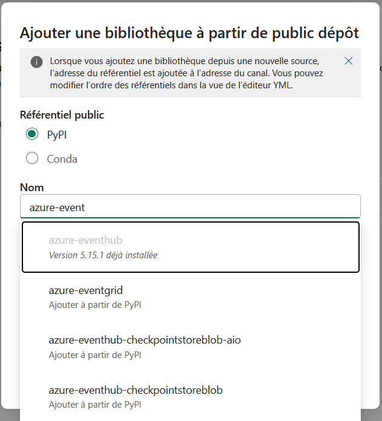
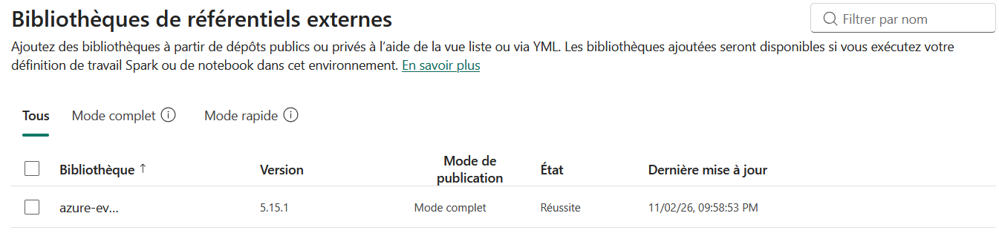

# Descriptif rapide 
- Nom : streaming_librairies
- Type : Environment
- Date de modification : 03/11/2026
- Description : un environnement Spark/Python créé spécifiquement pour ajouter Azure-EventHub

Sommaire pour explorer d'autres types, ressources :

- [Accueil](../../../../README.md)
- [Environnement](../README.md)

## Quoi ?

C'est un élément d'environnement de spark/python permettant d'installer en plus des dépendances de base l'extension Event Hubs. 

Cet environnement est donc utilisé par le notebook **NB_Event_Meteo_France** pour le streaming de nos données météorologiques à envoyer à notre eventstream **evenstream_meteo_france**.

## Pourquoi ?

Nous évitons de répéter l'installation de cette dépendance et facilite la gestion des bibliothèques de streaming.

## Sources et destinations — Flux de données et dépendances

### Source 

Pas de source.

### Destination

Utilisé par le notebook pour pouvoir créer le producer et envoyé les événements météorologiques.

## Comment ?

On a créé d'abord l'élément "Environnement" avec le nom donné. 

Ensuite, nous avons ajouté la librairie python en plus qui est *azure-eventhub* avec **PyPI**. 

Enfin, après installation au bout de **10 minutes**, nous avons la librairie d'installée qui peut être utilisé par tout notebook utilisant cet environnement.

