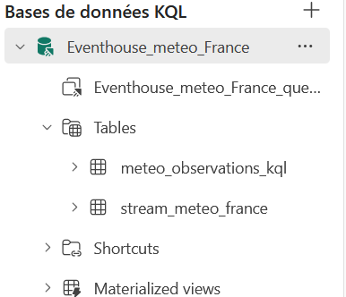
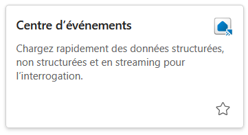

# Descriptif rapide 
- Nom : Eventhouse_meteo_France
- Type : Eventhouse
- Date de modification : 17/11/2026
- Description : un stockage d'événements en directs des activités des mesures météorologiques

Sommaire pour explorer d'autres types, ressources :

- [Accueil](../../../../README.md)
- [Eventhouse](../README.md)

## Quoi ?

C'est un élément de stockage d'événements en directs de nos mesures météorologiques dans notre espace de travail.

Ces données stockées proviennent de l'eventstream **Eventstream_meteo_France** qui les envoits.

Elle permets donc de les stocker et de pouvoir les analyser via des requêtes KQL.

## Pourquoi ?

Il permets de savoir en direct la météo qui se déroule en France à travers différentes stations.

Ces données sont actualisées toutes les six minutes et ont donc besoin d'être envoyées en continue.

Cela implique donc l'importance de cet eventhouse pour les capturer en *quasi temps réels* les mesures météorologiques.

Elles sont stockées dans cet eventhouse dans une base de données KQL nommée **Eventhouse_meteo_France** 

## Sources et destinations — Flux de données et dépendances

### Source 

Les mesures météorologiques observées par les stations via l'eventstream **Eventstream_meteo_France**.

### Destination

Enregistrées dans cet eventhouse en question dans sa base de données KQL.

## Comment ?

Pour créer cet eventhouse, il faut aller sur créer nouvel élément et cliquer sur le bouton *Centre d'événements*.

Ensuite, il faut renseigner le nom de cet nouvel élément et cliquer sur *Créer*.

L'eventhouse sera alors créé et il faudra le définir dans une destination d'un EventStream pour pouvoir lui envoyer des données en directs 
(dans notre cas **Eventstream_meteo_France**)