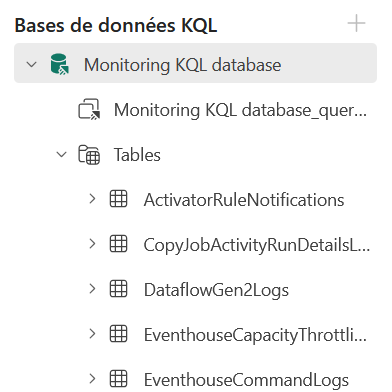
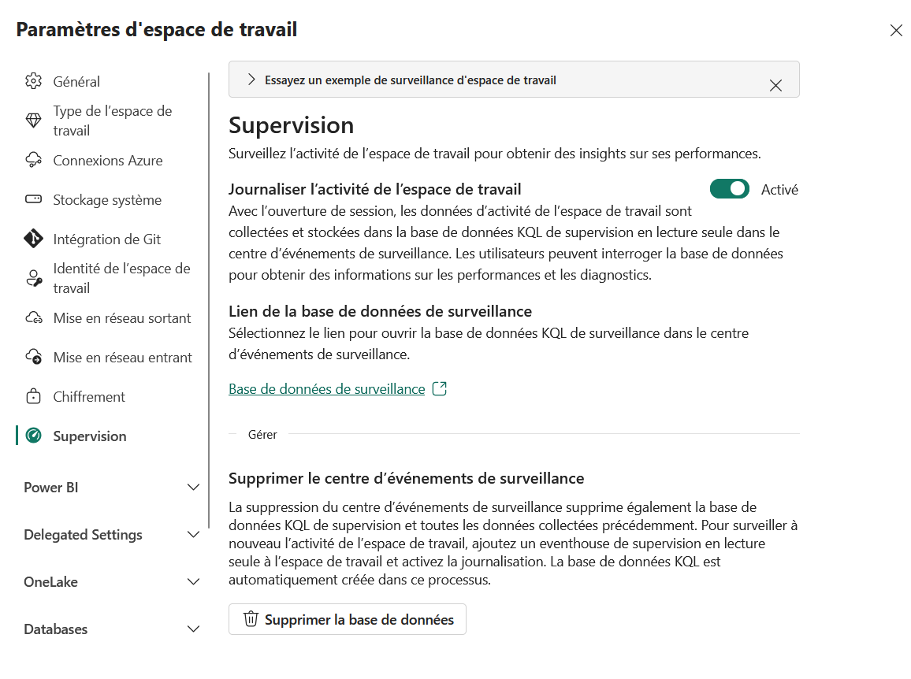

# Descriptif rapide 
- Nom : Monitoring_Eventhouse
- Type : Eventhouse
- Date de modification : 16/11/2026
- Description : un stockage d'événements en directs des activités dans l'espace de travail concerné

Sommaire pour explorer d'autres types, ressources :

- [Accueil](../../../../README.md)
- [Eventhouse](../README.md)

## Quoi ?

C'est un élément de stockage d'événements en directs de nos activités (dbt jobs, notebooks, etc) dans notre espace de travail.

Ces données stockées proviennent de l'eventstream **Monitoring_Eventstream** qui les envoits.

Elle permets donc de les stocker et de pouvoir les analyser via des requêtes KQL.

## Pourquoi ?

Il permets de savoir le temps, les succès et échec de nos exécutions planifiés.

Elles sont stockées dans cet eventhouse dans une base de données KQL nommée **Monitoring KQL Database** 

## Sources et destinations — Flux de données et dépendances

### Source 

Les logs d'activités à succès, en attente ou en échec dans cet espace de travail envoyées par l'eventstream **Monitoring_Eventstream**.

### Destination

Enregistrées dans cet eventhouse en question dans sa base de données KQL.

## Comment ?

Comment créer cet eventStream avec l'eventhouse est hyper simple, il suffit juste d'aller les paramètres de l'espace de travail et ensuite aller sur l'onglet **Supervision** et cliquer sur la case à cocher *Journaliser l'activité de l'espace de travail*.

Cela permettra de créer automatiquement l'eventstream et l'eventhouse pour collecter les données des activités exécutées dans cet espace et donc procéder à une supervision dans nos traitements planifiés.

