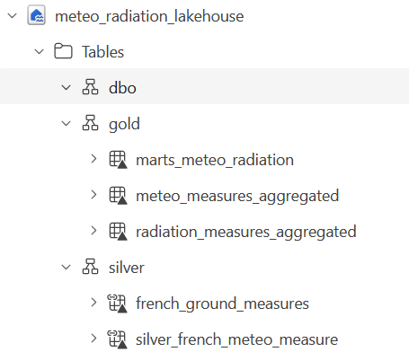
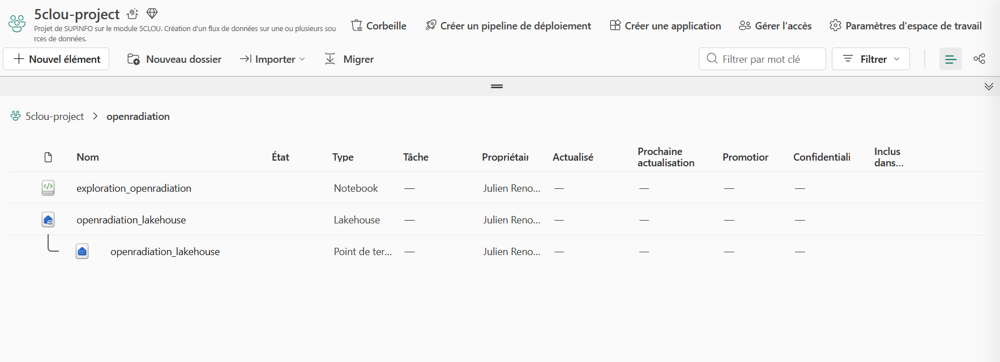
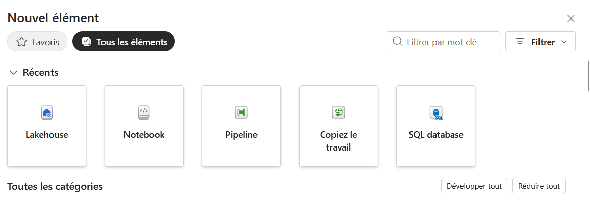

# Descriptif rapide 
- Nom : Lakehouse_meteo_France
- Type : Lakehouse
- Date de modification : 18/11/2026
- Description : un lakehouse qui servira à contenir toutes les tables et fichiers concernant la liaison des mesures de radiations et météorologiques.

Sommaire pour explorer d'autres types, ressources :

- [Accueil](../../../../README.md)
- [Lakehouse](../README.md)

## Quoi ?

C'est un élément central pour notre flux de données de liaison car il va contenir toutes les tables/fichiers les concernant.

## Pourquoi ?

L'objectif est de traiter à part la liaison des mesures en créant un lakehouse qui sera le centre pour ces différentes tables.

Cela simplifiera l'organisation des tables et de seulement observer les tables analytiques concernant les mesures liées.

## Sources et destinations — Flux de données et dépendances

### Source 

Récupération des données depuis les deux Lakehouses **Lakehouse_meteo_France** avec la table **silver_french_meteo_measures** 
et **Openradiation_lakehouse** avec la table **french_ground_measures**.

### Destination

Elle contiendra tous ces fichiers et tables concernant les mesures liées à l'aide d'une architecture en médaillon.

## Comment ?

Pour créer cet élément, nous devions cliquer sur "Nouvel élément" et cliquer ensuite sur l'élément en titre *lakehouse*.

Enfin, on devait donner un nom à notre lakehouse et il sera créé dans notre espace.