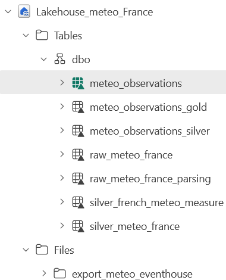
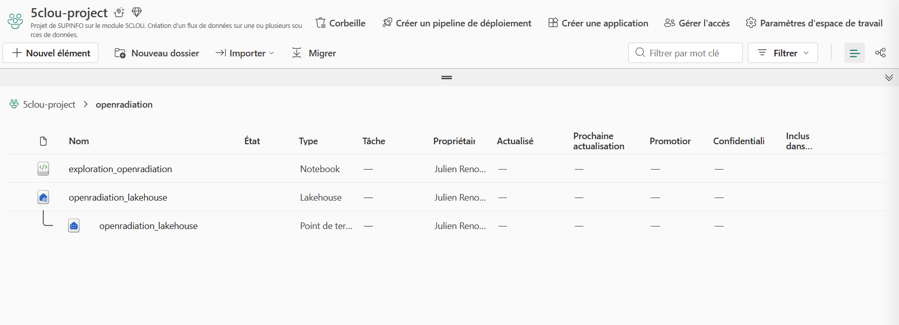
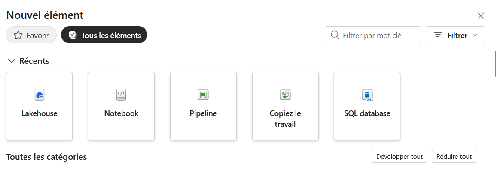

# Descriptif rapide 
- Nom : Lakehouse_meteo_France
- Type : Lakehouse
- Date de modification : 17/11/2026
- Description : un lakehouse qui servira à contenir toutes les tables et fichiers concernant les mesures météorologiques seulement.

Sommaire pour explorer d'autres types, ressources :

- [Accueil](../../../../README.md)
- [Lakehouse](../README.md)

## Quoi ?

C'est un élément central pour notre flux de données des mesures météorolgiques car il va contenir toutes les tables/fichiers les concernant.

## Pourquoi ?

L'objectif est de séparer les données météorologiques des données de radiations et de seulement se concentrer sur les mesures météorologiques en faisant une mise à jour journalière des données et liées ensuite avec les mesures de radiations.

## Sources et destinations — Flux de données et dépendances

### Source 

Récupération des données depuis l'eventhouse **Eventhouse_meteo_France**

### Destination

Elle contiendra tous ces fichiers et tables concernant les mesures météorologiques à l'aide d'une architecture en médaillon.

## Comment ?

Pour créer cet élément, nous devions cliquer sur "Nouvel élément" et cliquer ensuite sur l'élément en titre *lakehouse*.

Ensuite, on devait donner un nom à notre lakehouse et il sera créé dans notre espace.