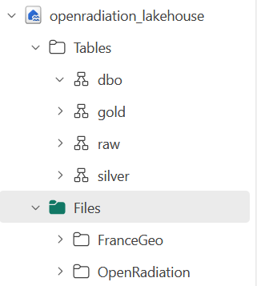
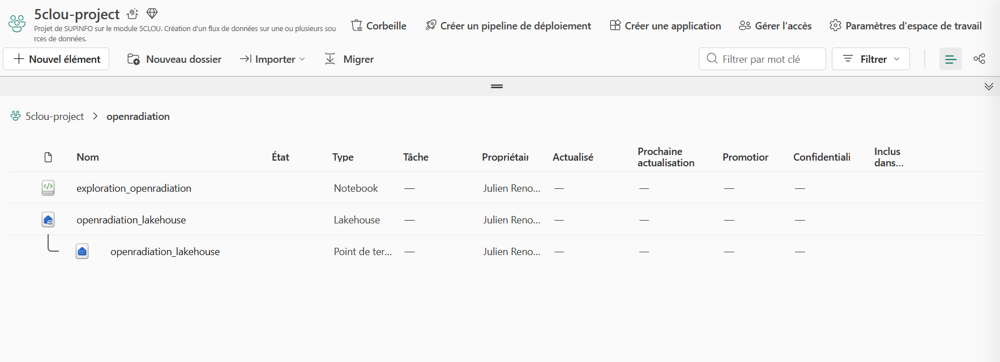
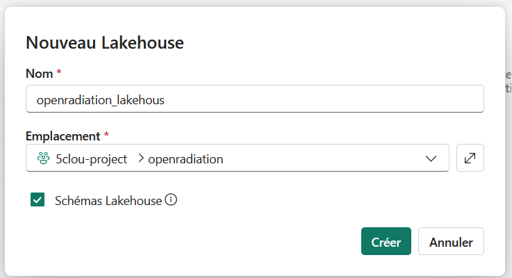

# Descriptif rapide 
- Nom : openradiation_lakehouse
- Type : Lakehouse
- Date de modification : 25/10/2026
- Description : un lakehouse qui servira à contenir toutes les tables et fichiers concernant les mesures de radiations seulement.

## Quoi ?

C'est un élément central pour notre flux de données des radiations car il va contenir toutes les tables/fichiers les concernant.

## Pourquoi ?

L'objectif est de séparer les données météorologiques des données de radiations et de seulement se concentrer sur les radiations afin de proposer une analyse plus précise sur eux.

## Sources et destinations — Flux de données et dépendances

### Source 

Récupération d'un fichier compressé tar à partir de la requête ci-dessous :

https://request.openradiation.net/openradiation_dataset.tar.gz

### Destination

Elle contiendra tous ces fichiers et tables concernant la radiation à l'aide d'une architecture en médaillon.

## Comment ?

Pour créer cet élément, nous devions cliquer sur "Nouvel élément" et cliquer ensuite sur l'élément en titre *lakehouse*.

Ensuite, on devait donner un nom à notre lakehouse et il sera créé dans notre espace.

