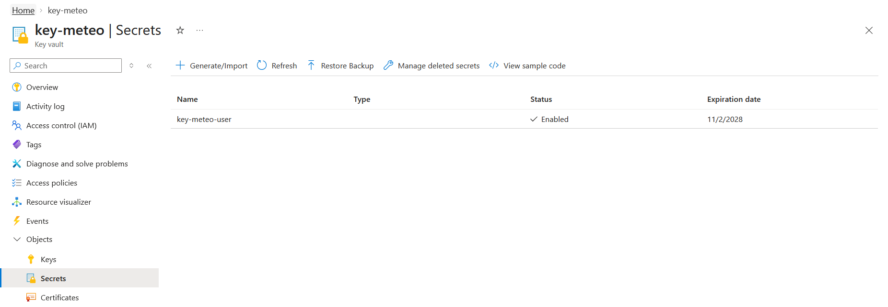
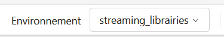
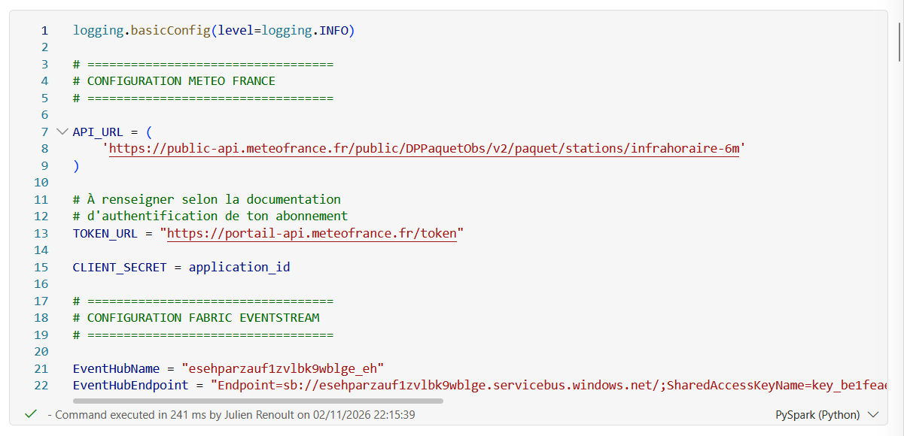
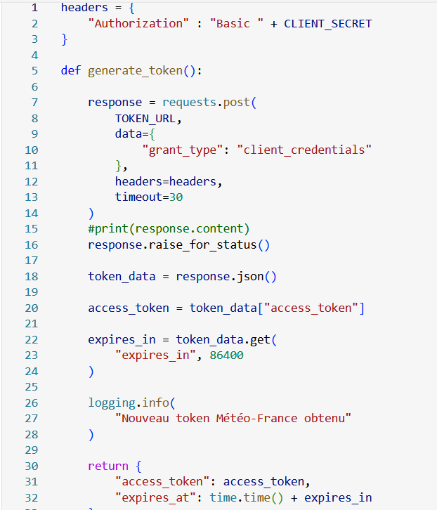
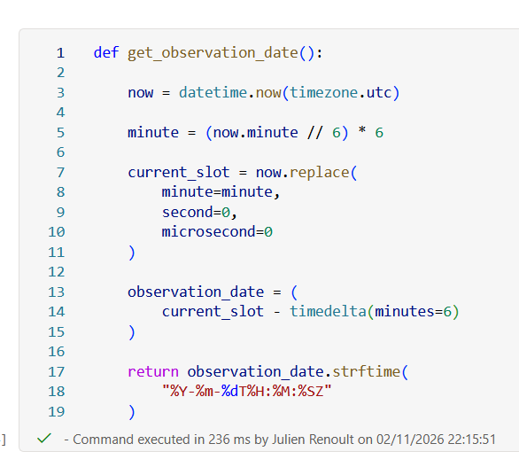
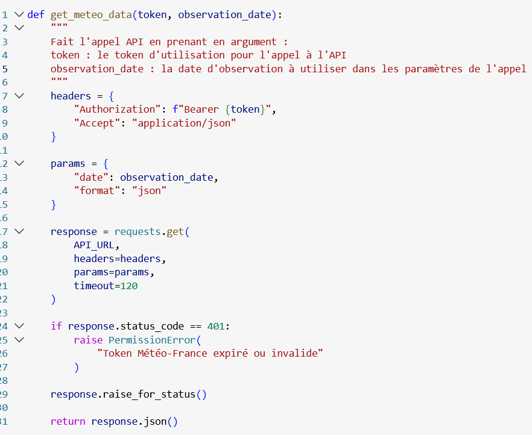
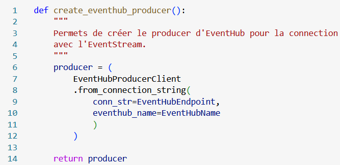
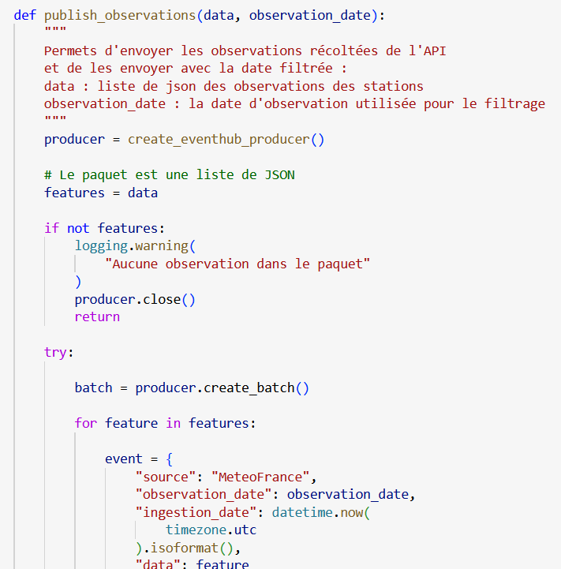
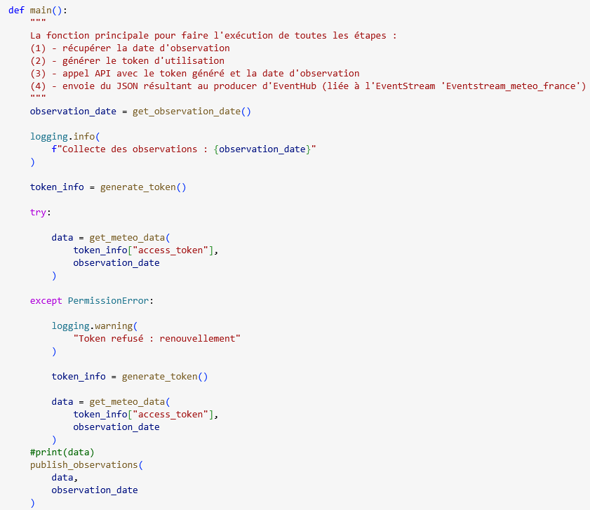

# Descriptif rapide 
- Nom : NB_Event_Meteo_France
- Type : Notebook python pyspark
- Date de modification : 03/11/2026
- Description : un notebook qui fait du micro-batch/streaming sur les observations météorologiques des stations toutes les 6 minutes

## Quoi ?

C'est un élément de notebook streaming qui va envoyer des observations météorologiques toutes les six minutes à notre eventstream via un producer azure-EventHub.

## Pourquoi ?

Cela permets de faire du quasi temps réels en récupérant les mesures météorologiques toutes les six minutes très facilement.

Le notebook est le choix le plus adapté pour pouvoir configurer facilement notre producer et l'interaction avec l'eventstream en envoyant quelles données.


## Sources et destinations — Flux de données et dépendances

### Source 

Récupération via deux appels API pour la génération du token d'utilisation et de la récupération des mesures météorologiques :

```
# Génération du token d'utilisation
https://portail-api.meteofrance.fr/token

# Récupération des mesures météorologiques de toutes les stations
https://public-api.meteofrance.fr/public/DPPaquetObs/v2/paquet/stations/horaire?date=...&format=json
```

### Destination

Le résultat JSON des APIs va être enregistré en envoyant via notre producer à l'eventstream **evenstream_meteo_france** qui va envoyer à l'eventhouse **Event_meteo**.

## Comment ?

Tout d'abord, il fallait créer une ressource Azure *Key Vault* qui permet de donner des secrets sans pour autant qui soit exposé. Cela concerne notamment la clé d'accès pour générer le token OAuth d'utilisation des observations météorologiques !



Ensuite, nous avons configuré notre notebook pour qu'il utilise l'environnement **streamig_librairies** qui permettent d'avoir les dépendances python pour l'eventhub. Utile pour l'envoie au flux de streaming.



Après config de l'environnement, on configure nos clés et accès d'une part à l'API météo france avec la clé client et de l'autre sur l'eventhub en récupérant ses informations dans le custom stream de l'eventhub.



Maintenant que toute la configuration, on va définir les différentes étapes à effectuer notamment en premier la génération du token OAuth d'utilisation grâce à la clé d'accès client.



En deuxième étape, la création de la date d'observation à utiliser pour filtrer sachant que ça doit être un multiple de 6 et avoir 0 seconde au bout.



La troisième étape va être de faire appel à l'API d'observation des stations avec le token + la date d'observation générée.



La quatrième étape est de publier ces observations via notre producer à l'aide de la config eventhub faits précedemment et on envoie les JSON d'observations (on les envoie séparément, pas toute la liste d'un seul coup).





Toutes ces étapes seront appliquées dans une fonction main les exécutant dans cet ordre.



## Fichiers associés 

Les fichiers associés à cet élément sont  :

| Fichier | Rôle |
|---|---|
| `notebooks/NB_Event_Meteo_France.ipynb` | Notebook de streaming des observations de stations |
| `notebooks/NB_Event_Meteo_France.html` | Notebook en version HTML pour observer les résultats sans exécuter de code |