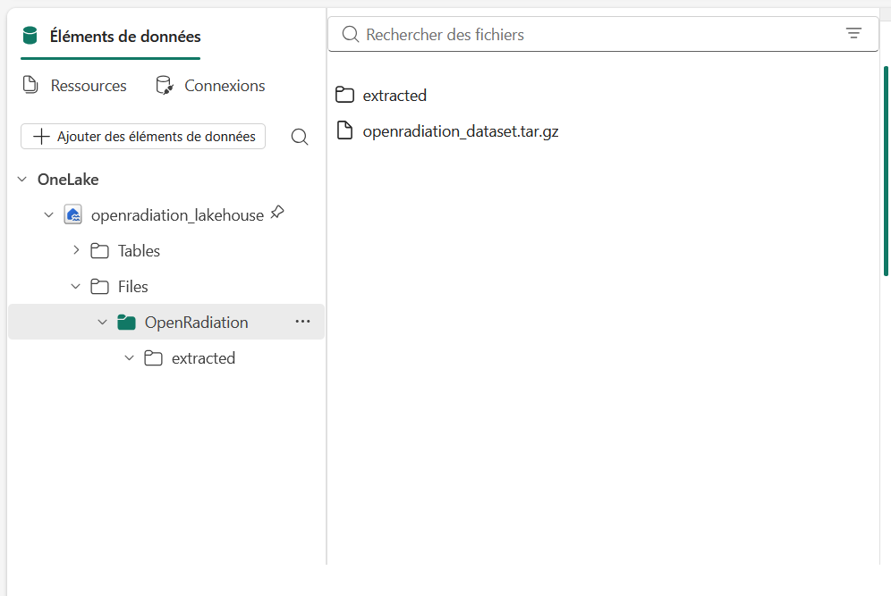

# Descriptif rapide 
- Nom : exploration_openradiation
- Type : Notebook python pyspark
- Date de modification : 25/10/2026
- Description : un notebook qui permets d'explorer les jeux de données dans le fichier compressé avant instauration d'une pipeline d'ingestion

Sommaire pour explorer d'autres types, ressources :

- [Accueil](../../../../../README.md)
- [Notebooks](../../README.md)

## Quoi ?

C'est un élément seulement **d'exploration** qui nous permets de regarder directement la structure de nos jeu de données.

Elle est seulement dépendante du lakehouse **openradiation_lakehouse** qui va contenir les données d'openradiation dans ses différentes transformations.

## Pourquoi ?

Il répond surtout à la problématique de ce qu'on en a face comme jeu de données. D'observer sa structure, les proportions des données manquantes et d'en comprendre la signification des colonnes présentes.

Il nous permettra de déterminer la pipeline à appliquer pour extraire seulement les données qui nous intéressent.

Le notebook est donc un choix parfait pour explorer le jeu de données sans interférer dans la suite de la création du flux.

## Sources et destinations — Flux de données et dépendances

### Source 

Récupération d'un fichier compressé tar à partir de la requête ci-dessous :

https://request.openradiation.net/openradiation_dataset.tar.gz

### Destination

Qui va ensuite être enregistré avec les jeu de données CSV dans le lakehouse **openradiation_lakehouse** partie Files dans le dossier "OpenRadiation".

## Fichiers associés 

Les fichiers associés à cet élément sont  :

| Fichier | Rôle |
|---|---|
| `notebooks/exploration_openradiation.ipynb` | Notebook d'exploration des données brutes de radiations |
| `notebooks/exploration_radiation.html` | Notebook en version HTML pour observer les résultats sans exécuter de code |
