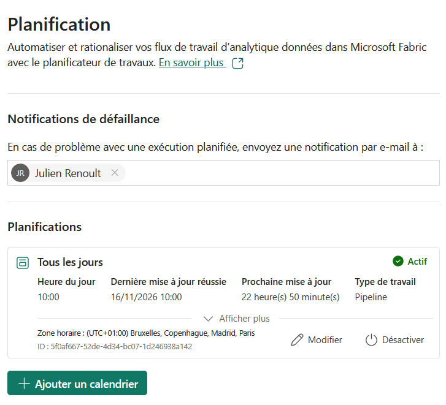
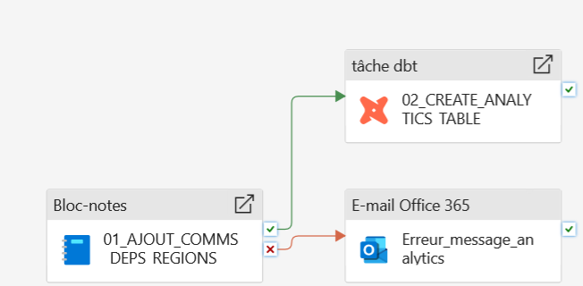
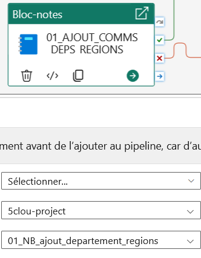
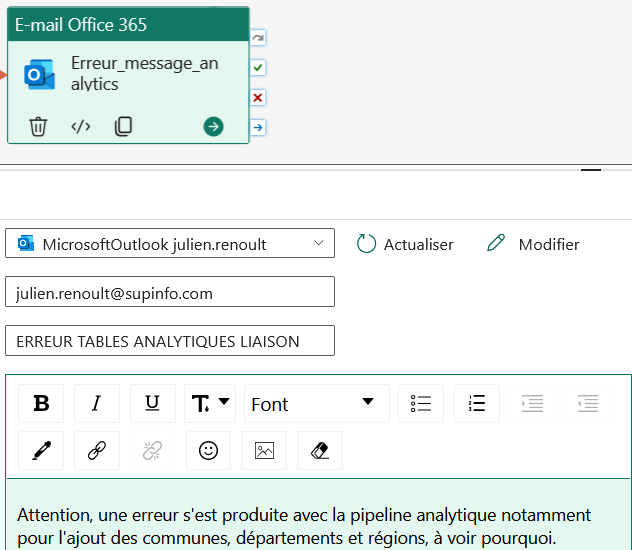
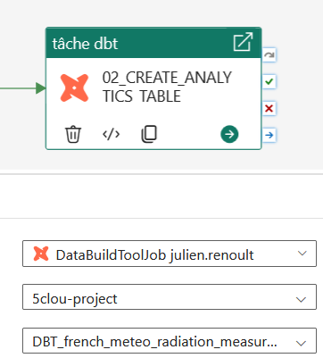

# Descriptif rapide 
- Nom : PL_liaison_meteo_radiation
- Type : Pipeline
- Dossier : openradiation
- Date de modification : 16/11/2026
- Description : une pipeline s'exécutant quotidiennement qui gère la liaison entre les données météorologiques et de radiations.

Sommaire pour explorer d'autres types, ressources :

- [Accueil](../../../../README.md)
- [Pipelines](../README.md)

## Quoi ?

C'est un élément de pipeline qui va exécuter un notebook et un job dbt pour créer les tables analytiques orientées vers la France.

Les données utilisées sont dans les lakehouses **openradiation_lakehouse**, **lakehouse_meteo_France** et les tables résultantes sont dans le lakehouse **meteo_radiation_lakehouse**.

## Pourquoi ?

Dans notre projet 5CLOU, nous voulions lier les données météorologiques avec les mesures de radiations naturelles se déroulant en France. Cependant, il nous faut les informations géographiques (régions, départements, communes) pour pouvoir les lier entre elles. Ces données ne possédaient que les coordonnées (latitude, longitude) où les mesures où ont été prises.

Nous avons donc créé cette pipeline pour ajouter les informations géographiques françaises et lier les mesures entre elles.

L'exécution se fait quotidiennement à 10h pour toujours avoir les données à jour.

Ce pipeline permets donc de gérer facilement la liaison entre ces mesures en France.

## Comment ?

Pour le créer, il suffit de créer un notebook pyspark gérant l'ajout des informations géographiques et un dbt job pour créer les tables liées entre ces deux mesures aggrégées au niveau de la région française.

### 1. Ajouter les informations géographiques

Tout d'abord, notre pipeline doit filtrer et préparer les mesures qui sont déroulées en France.

Pour ce faire, un notebook pyspark avec une dépendance Spark ajoutée nommée **Sedona** pour l'aspect spatio-temporel avec les coordonnées. 

Les tables seront enregitrées dans leurs lakehouses respectives (**silver_french_measures** pour le lakehouse **Lakehouse_meteo_France** et **french_ground_measures** pour le lakehouse **openradiation_lakehouse**) contenant les mesures relévées en France.

En cas d'erreur, un mail d'erreur sera envoyé à l'équipe pour cette étape et qu'il le corrige rapidement.

### 2. Création des tables analytiques

Maintenant que les mesures de radiations et météo ont été préparées, on termine par la création de nos tables analytiques.

Cela se fait à travers l'exécution d'un dbt job pour créer les différentes tables analytiques.

## Fichiers associés

Le pipeline `PL_liaison_meteo_radiation`
s'appuie sur plusieurs ressources Microsoft Fabric.

### Notebooks associés

| Notebook | Rôle |
|---|---|
| `01_NB_ajout_departement_regions` | Filtrage et préparation des données de mesures se déroulant en France |

### Jobs DBT associés

| DBT job | Rôle |
|---|---|
| `DBT_french_meteo_radiation_measures` | création des tables analytiques de mesures de radiations/météorologiques liées par la région relevée, utilisées ensuite par le rapport Power BI concerné |

### Ressources de données associées

| Ressource | Nom | Rôle |
|---|---|---|
| Lakehouse | `openradiation_lakehouse` | Stockage des données de mesures de radiations utilisées par les traitements |
| Lakehouse | `Lakehouse_meteo_France` | Stockage des données de mesures météorologiques utilisées par les traitements |
| Lakehouse | `meteo_radiation_lakehouse` | Stockage des données de mesures météorologiques/radiation liées utilisées par les traitements |
| Table Silver | `silver.ground_measures` | Conservation des mesures au sol nettoyées |
| Table Silver | `silver.french_ground_measures` | Conservation des mesures au sol nettoyées relevées en France |
| Table Silver | `dbo.silver_french_measures` | Conservation des mesures métérologiques des stations relevées en France |

Pour les tables créées par le job dbt :

| Ressource | Nom | Rôle |
|---|---|---|
| Table Gold | `gold.radiation_measures_aggregated` | Conservation des mesures de radiation au sol relevées en France aggrégée au niveau régional |
| Table Gold | `gold.meteo_measures_aggregated` | Conservation des mesures météorologiques relevées en France aggrégées au niveau régional |
| Table Gold | `gold.marts_meteo_radiation` | Conservation des mesures météorologiques et radiations en France aggrégées au niveau régional |

