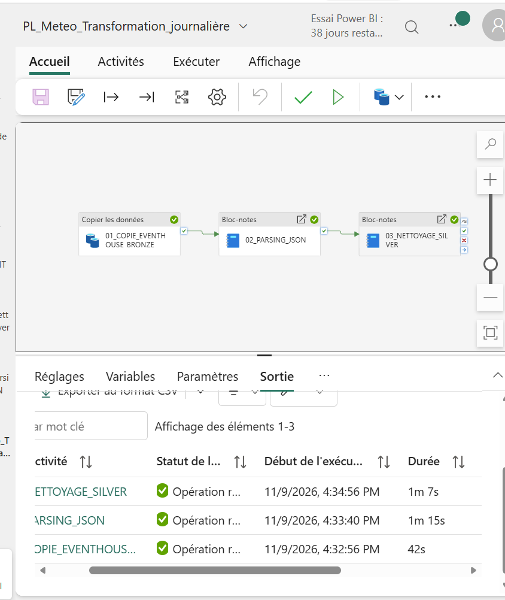
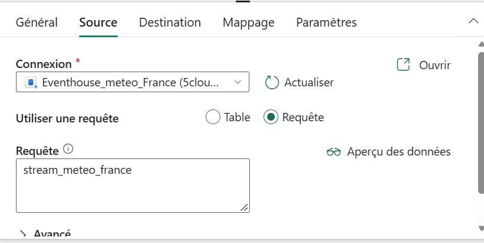
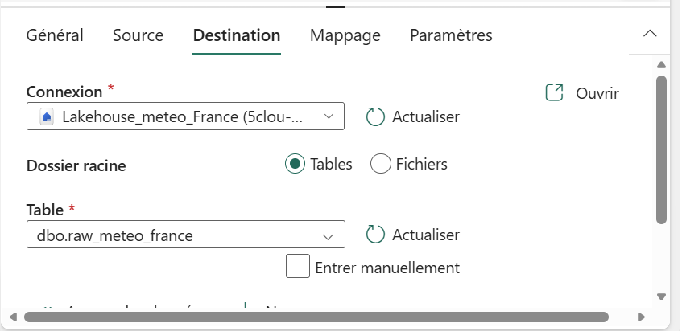
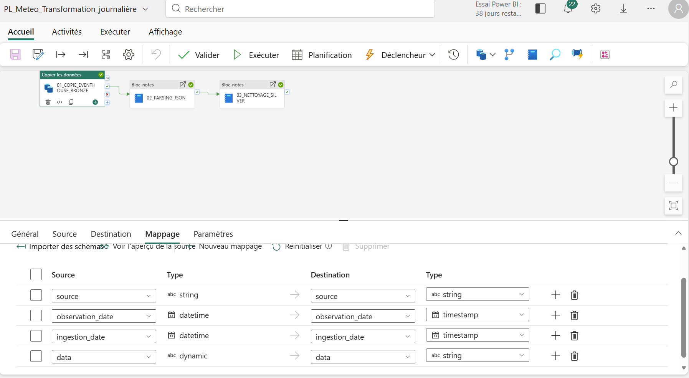

# Pipeline de transformation quotidienne des données météorologiques

## 1. Descriptif 

- **Nom :** PL_Meteo_Transformation_journalière
- **Type :** Pipeline de données Microsoft Fabric
- **Espace de travail :** 5clou-project
- **Dossier :** Meteo
- **Fréquence d'exécution :** Quotidienne, à 9 h (heure de Paris)

Ce pipeline permet d'automatiser la préparation quotidienne
des observations météorologiques issues de Météo-France.

Il organise les traitements en trois étapes successives :
copie des données depuis Eventhouse vers la couche Bronze,
extraction des données JSON, puis nettoyage et préparation
de la couche Silver.

### Capture d'écran du pipeline

*Figure 1 — Exécution réussie des trois activités du pipeline
de transformation quotidienne des données météorologiques.*

## 3. Pourquoi ?

Dans notre projet 5CLOU, les observations météorologiques
collectées depuis Météo-France sont d'abord stockées dans
Eventhouse. Cependant, ces données brutes ne sont pas
directement adaptées à toutes les analyses.

Nous avons donc créé ce pipeline pour automatiser leur
préparation et éviter de répéter manuellement les mêmes
traitements.

Il répond à quatre besoins principaux :

- **Automatiser les traitements :** exécuter quotidiennement
  les étapes de copie, de structuration et de nettoyage.

- **Organiser les données :** conserver les observations
  brutes dans la couche Bronze et les données nettoyées
  dans la couche Silver.

- **Améliorer la qualité des données :** extraire les
  informations utiles du JSON et convertir les températures
  en degrés Celsius.

- **Faciliter les analyses :** disposer de données
  structurées et préparées pour les traitements
  analytiques ultérieurs.

L'exécution quotidienne à 9 h (heure de Paris) permet
de mettre à jour automatiquement les données préparées,
sans lancer manuellement chaque notebook.

Ce pipeline constitue ainsi une étape de transformation
entre le stockage des observations dans Eventhouse
et leur exploitation analytique dans le Lakehouse.

## 4. Sources et destinations

Notre pipeline utilise les observations météorologiques
collectées depuis l'API Météo-France et stockées
dans Microsoft Fabric.

| Étape | Source | Destination |
|---|---|---|
| 1. Copie Bronze | Eventhouse `Eventhouse_meteo_France`, table `stream_meteo_france` | Lakehouse `dbo.raw_meteo_france` |
| 2. Parsing JSON | `dbo.raw_meteo_france` | `dbo.raw_meteo_france_parsing` |
| 3. Nettoyage Silver | `dbo.raw_meteo_france_parsing` | `dbo.silver_meteo_france` |

### Organisation des couches de données

- **Eventhouse :** reçoit et conserve les observations
  météorologiques issues du flux de collecte.

- **Bronze :** stocke une copie des observations brutes
  dans le Lakehouse.

- **Parsing :** extrait et structure les informations
  contenues dans les données JSON.

- **Silver :** contient les observations nettoyées
  et préparées pour les analyses.

Le pipeline permet ainsi de faire évoluer les données
depuis leur stockage initial vers une forme plus
facilement exploitable.

## 5. Comment ?

### 5.1. Copie des données Eventhouse vers Bronze

La première activité du pipeline est nommée
`01_COPIE_EVENTHOUSE_BRONZE`.

Nous avons utilisé l'activité **Copier les données**
de Microsoft Fabric pour transférer les observations
météorologiques depuis la table `stream_meteo_france`
de l'Eventhouse `Eventhouse_meteo_France` vers la table
`dbo.raw_meteo_france` du Lakehouse.

Cette étape permet de conserver les données brutes
dans la couche Bronze, avant les traitements de
structuration et de nettoyage.

#### Configuration de la source

La source de l'activité de copie est l'Eventhouse
`Eventhouse_meteo_France`.

Nous avons sélectionné le mode `Requête` et renseigné
`stream_meteo_france` pour accéder aux observations
météorologiques.

*Figure 2 — Configuration de la source Eventhouse
dans l'activité de copie du pipeline.*

#### Configuration de la destination

La destination de l'activité de copie est le Lakehouse
`Lakehouse_meteo_France`.

Nous avons sélectionné le dossier racine `Tables`
et la table `dbo.raw_meteo_france` pour enregistrer
les observations météorologiques brutes.

Cette table constitue la couche Bronze de notre
architecture de données.

*Figure 3 — Configuration de la destination Lakehouse
et de la table Bronze.*

#### Mappage des colonnes

L'onglet `Mappage` permet de définir la correspondance
entre les colonnes de la source Eventhouse et celles
de la table de destination dans le Lakehouse.

Les colonnes sources identifiées sont :

| Colonne source | Type source | Colonne destination | Type destination |
|---|---|---|---|
| source | string | source | string |
| observation_date | datetime | observation_date | timestamp |
| ingestion_date | datetime | ingestion_date | timestamp |
| data | dynamic | data | string 

