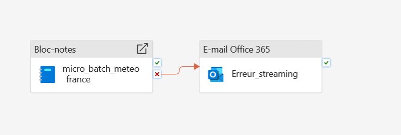
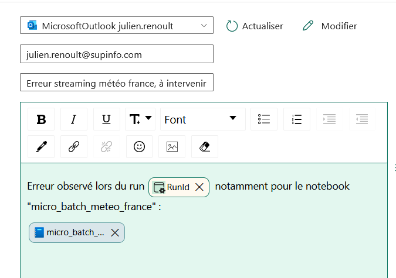
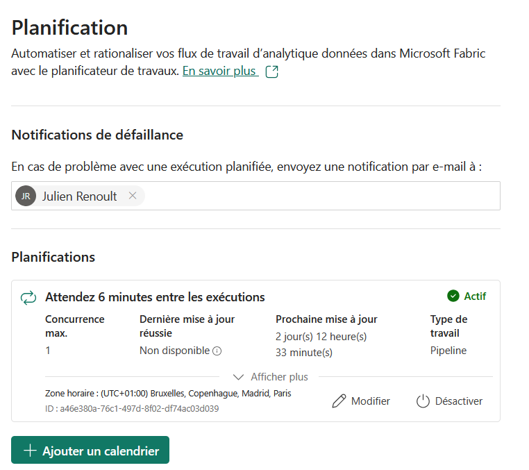

# Descriptif rapide 
- Nom : micro_batch_stream_meteo
- Type : Pipeline
- Date de modification : 03/11/2026
- Description : une pipeline s'exécutant toutes les six minutes pour capturer les mesures météorologiques de nos stations

Sommaire pour explorer d'autres types, ressources :

- [Accueil](../../../../../README.md)
- [Pipelines](../../README.md)

## Quoi ?

C'est un élément de pipeline qui va exécuter le notebook de streaming **NB_Event_Meteo_France** envoyant les données de météorologies.

## Pourquoi ?

Il permets de gérer facilement la planification et le monitoring en cas d'erreur d'exécution du notebook avec la possibilité d'ajouter d'autre activités à réaliser en plus.

## Comment ?

Pour le créer, c'est tout simple. il suffit d'ajouter une activité d'exécution de notebook qu'on fait sur notre notebook de streaming.

On ajoutera un email à envoyer en cas d'erreur de l'exécution du notebook de streaming car cela révèle d'une importance capitale à résoudre.

Dans ce mail d'erreur, nous allons l'envoyer à mon adresse mail avec des informations comme le RunId et les détails du job sur le micro batch du notebook.

Une planification est ajoutée pour qu'il s'exécute toutes les six minutes en micro-bactch donc en quasi temps réels.

