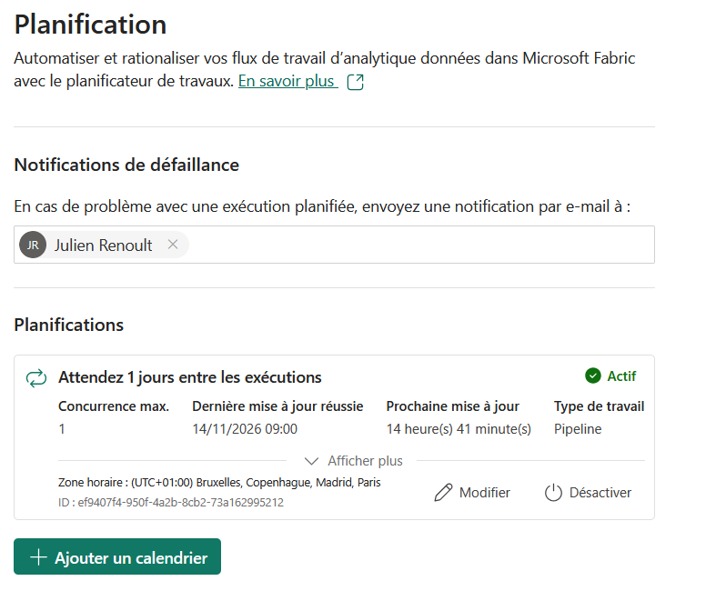
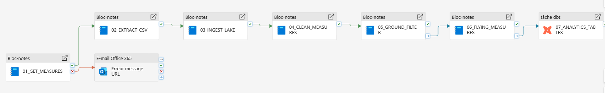
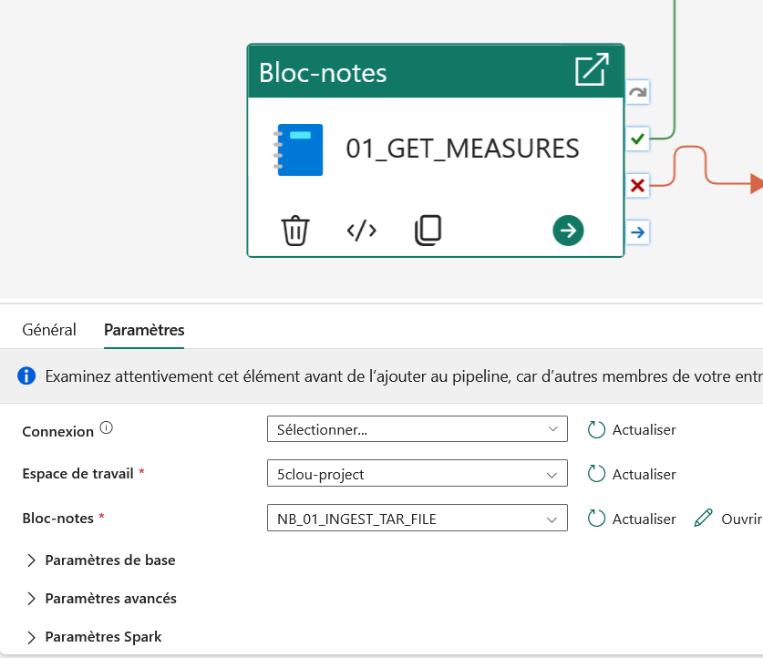
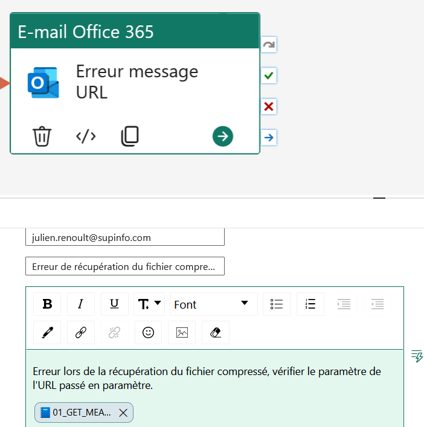
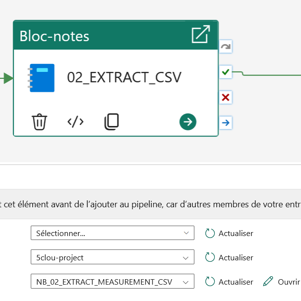
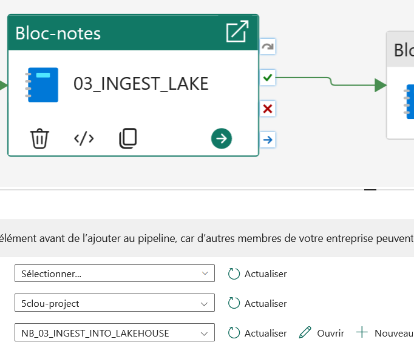
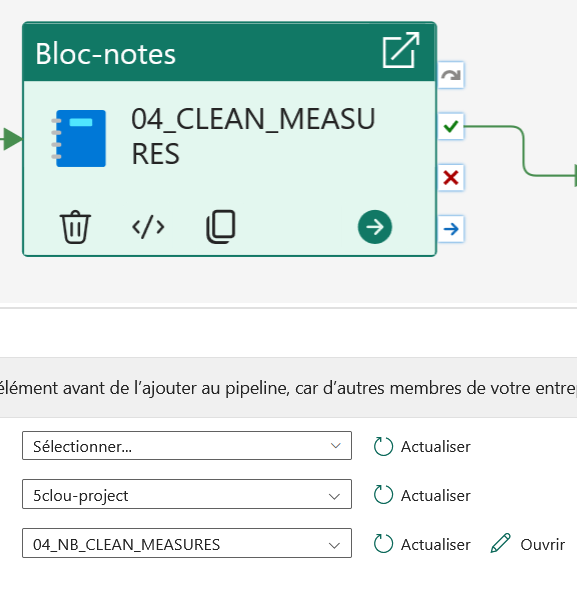
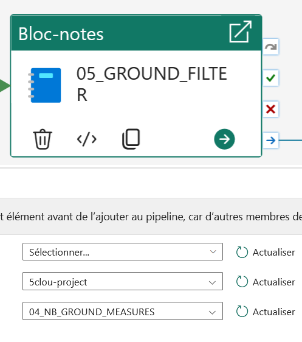
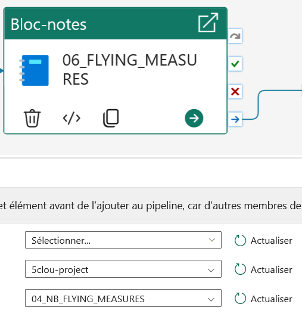
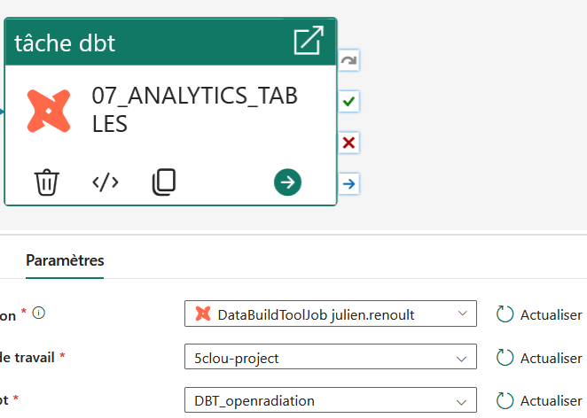

# Descriptif rapide 
- Nom : PL_openradiation_measues
- Type : Pipeline
- Dossier : openradiation
- Date de modification : 14/11/2026
- Description : une pipeline s'exécutant quotidiennement qui gère l'ingestion, le nettoyage et la préparation des données de mesures de radiations.

## Quoi ?

C'est un élément de pipeline qui va exécuter différents notebooks représentant les différentes étapes de préparation de nos données

sur les mesures de radiations depuis le fichier compressé aux tables silver dans le lakehouse **openradiation_lakehouse**.

## Pourquoi ?

Dans notre projet 5CLOU, nous voulions utiliser 
les mesures de radiations naturelles collectés par l'association [OpenRadiation](https://www.openradiation.org/). Cependant, ces données sont mise à jour quotidiennement ce qui amène à devoir appliquer un traitement automatisé.

Nous avons donc créé cette pipeline pour récupérer, ingérer, nettoyer et transformer nos données de mesures de radiations.

L'exécution se fait quotidiennement à 9h pour toujours avoir les données à jour.

Ce pipeline permets donc de gérer l'insertion de ces données collectives dans notre lakehouse hyper facilement.

## Comment ?

Pour le créer, il suffit de créer plusieurs notabooks répondant à différentes étapes de traitements. À la fin, un dbt jobs sera exécuté pour créer les modèles analytiques pour ces mesures de radiations précisément.

### 1. Récupérer le fichier compressé (tar)

Tout d'abord, notre pipeline doit récupérer le fichier compressé contenant ces mesures de radiations.

Il devra exécuter une requête HTTP et ainsi écrire le fichier compressé dans le système de fichier du lakehouse concerné.

Si une erreur est aménée à se produire, un mail sera envoyé à l'équipe concerné pour prévenir précisément que c'est de cette étape et l'origine de cette erreur.

### 2. Extraction du fichier CSV

Quand la première étape est terminée avec succès, la deuxième étape sera lancée avec l'extraction du fichier CSV de mesures concerné.

Ca sera un autre notebook à exécuter précisément qui va enregistrer notre fichier CSV extrait dans notre système de fichiers du même lakehouse.

### 3. Ingestion du fichier CSV 

Si la deuxième étape est un succès, alors on peut passer à l'ingestion de notre fichier CSV dans une table du lakehouse.

Ca sera l'objectif principale de notre notebook en ingérant ces mesures dans une table nommée **radiation_measures** dans le schéma **raw** vu que ce sont des données brutes qui ont besoin d'être nettoyées.

### 4. Nettoyage des mesures de radiations

Ensuite, lorsque les données sont ingérées dans la table brute, un autre notebook nettoyera ces données et les enregistera dans une table à part nommée **clean_measures** dans le schéma **silver**. Les principales transformations appliquées sont notamment :
- la suppression des colonnes inutiles
- la suppression des mesures aberrantes (exemple : mesure contenant une date de fin < date de début, etc).
- la création de nouvelles colonnes (exemple : durée de la mesure)
- la conversion des types de colonnes

Toutes ces étapes jusqu'à ici doivent être exécutées successivement avec succès pour avoir des données à jour et de qualité.

### 5./6. Gestion des mesures au sol / au vol

Après nettoyage des données de mesures, nous allons séparer nos mesures en deux tables :
- **flying_measures** : mesures de radiations en vol
- **ground_measures** : mesures de radiations au sol

Cette séparation sera effectuée par l'exécution de deux notebooks filtrant sur chacun de ces types de mesures.

Il permettra ensuite de supprimer les colonnes inutiles selon le type de mesure (exemple : mesure au sol n'a pas d'information concernant l'aéroport de départ, ni d'arrivé donc aucun intérêt de garder ces colonnes).

### 7. Création des tables analytiques

Maintenant que les mesures de radiations sont séparées, la tâche dbt va pouvoir être exécutée.

L'objectif de cette dernière étape est de créer les tables analytiques utilisées par le modèle sémantique (*openradiation_analytics*) et par le Power BI (*report_OpenRadiation*).

## Fichiers associés

Le pipeline `PL_openradiation`
s'appuie sur plusieurs ressources Microsoft Fabric.

### Notebooks associés

| Notebook | Rôle |
|---|---|
| `NB_01_INGEST_TAR_FILE` | Ingestion du fichier compressé tar des mesures dans le lakehouse |
| `NB_02_EXTRACT_MEASUREMENT_CSV` | Extraction du fichier de mesure concerné |
| `NB_03_INGEST_INTO_LAKEHOUSE` | Ingestion du fichier dans une table brute du lakehouse |
| `04_NB_CLEAN_MEASURES` | Nettoyage des données de mesures |
| `04_NB_FLYING_MEASURES` | Capture dans une table à part seulement les mesures au vol |
| `04_NB_GROUND_MEASURES` | Capture dans une table à part seulement les mesures au sol |

### Jobs DBT associés

| DBT job | Rôle |
|---|---|
| `DBT_openradiation` | création des tables analytiques de mesures de radiations, utilisées ensuite par le rapport Power BI concerné |

### Ressources de données associées

| Ressource | Nom | Rôle |
|---|---|---|
| Lakehouse | `openradiation_lakehouse` | Stockage des données utilisées par les traitements |
| Table Bronze | `raw.radiation_measures` | Conservation des données brutes |
| Table Silver | `silver.clean_measures` | Conservation des données nettoyées |
| Table Silver | `silver.flying_measures` | Conservation des mesures au vol nettoyées |
| Table Silver | `silver.ground_measures` | Conservation des mesures au sol nettoyées |

Pour les tables créées par le job dbt :

| Ressource | Nom | Rôle |
|---|---|---|
| Table Gold | `gold.dim_apparatus` | Conservation des appareils de mesures et de leurs caractéristiques |
| Table Gold | `gold.fact_flying_measures` | Conservation des mesures au vol |
| Table Gold | `gold.fact_ground_measures` | Conservation des mesures au sol |
| Table Gold | `gold.marts_flying_measures` | Conservation des indicateurs statistiques des mesures au vol |
| Table Gold | `gold.marts_general_measures` | Conservation des indicateurs statistiques des mesures en générales |
| Table Gold | `gold.marts_ground_measures` | Conservation des indicateurs statistiques des mesures au sol |

