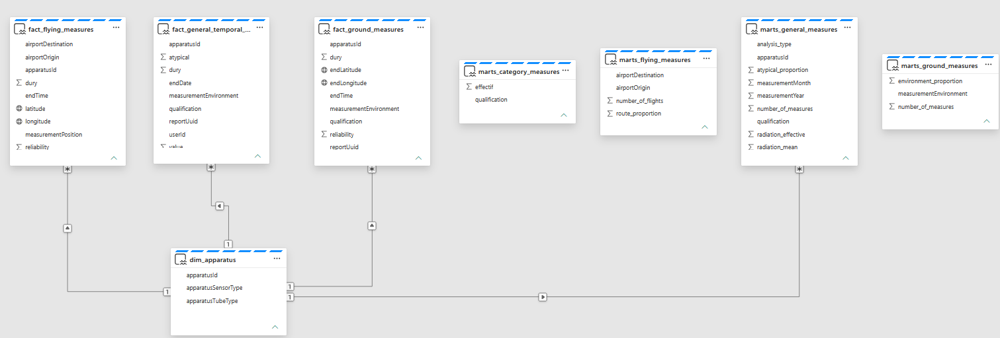
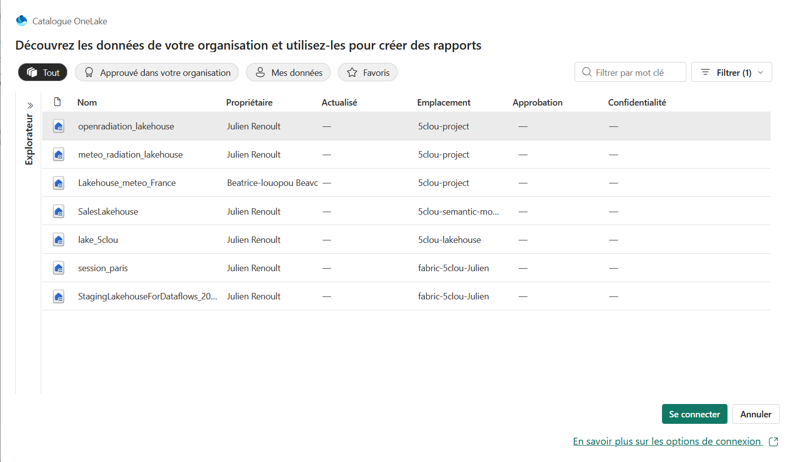
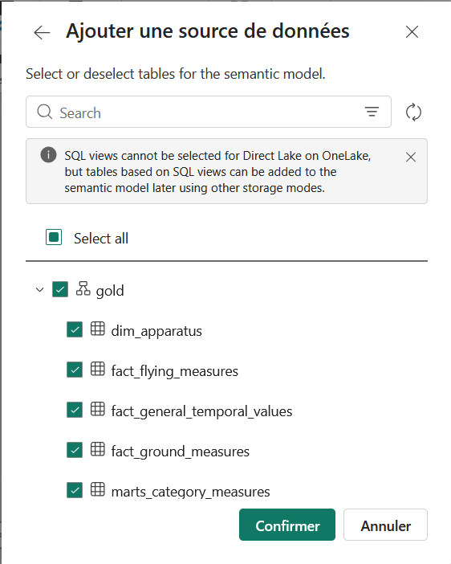

# Descriptif rapide 
- Nom : openradiation_analytics
- Type : Modèle sémantique 
- Date de modification : 18/11/2026
- Description : un modèle sémantique qui contient les tables analytiques des mesures de radiations

Sommaire pour explorer d'autres types, ressources :

- [Accueil](../../../../README.md)
- [Modèles sémantiques](../README.md)

## Quoi ?

C'est un élément qui sert à la création d'un modèle d'analyse pour après être utilisé dans un rapport Power BI.

Elle est seulement dépendante du lakehouse **openradiation_lakehouse** dont on récupère les tables analytiques dans le schéma *gold*.

## Pourquoi ?

Il sert principalement comme **étape de liaison** entre nos tables lakehouses et notre rapport Power BI avec insertion de nos relations.

Cela permets aussi de gérer plus facilement les formats des valeurs, les relations et mesures à calculer.

## Sources et destinations — Flux de données et dépendances

### Source 

Récupération des données dans les tables analytiques du lakehouse dans le schéma *gold*.

Une configuration dans le lakehouse devra être effectuée pour récupérer les tables concernées.

Ensuite, on choisit nos tables dans notre schéma *gold*.

### Destination

Enregistrement dans le modèle sémantique.
